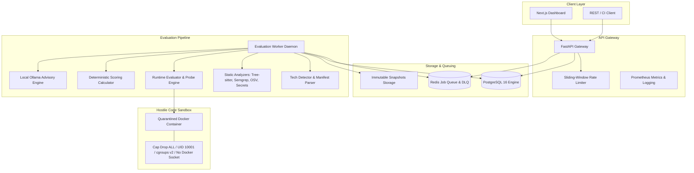

# RepoScore 🛡️⚡
### Autonomous Repository Intelligence & Software Evaluation Engine

[](https://www.python.org/)
[](https://fastapi.tiangolo.com)
[](https://nextjs.org)
[](https://www.postgresql.org/)
[](https://redis.io/)
[](https://www.docker.com/)
[](LICENSE)
[](tests/)

---

> **"Do not merely analyze what the code looks like. Determine what the software actually does."**  
> RepoScore combines deep static analysis, dependency vulnerability auditing, containerized runtime execution inside hardened sandboxes, 100% deterministic mathematical scoring, and bounded local-first AI reasoning to produce objective, evidence-backed evaluation scorecards.

---

## 🌟 Core Architectural Principles

1. **Evidence Over Assumption:** RepoScore evaluates software based exclusively on runtime behavior, AST metrics, OSV vulnerability queries, and empirical proof. Every point deduction in the scorecard links directly to an immutable evidence receipt.
2. **Deterministic Core:** Calculations, scoring models, and letter grades are 100% mathematical, versioned (`v1.0.0`), reproducible, and clamped in `[0.0, 100.0]`. The 10 dimension weights sum to exactly `1.000000`. Repeated evaluations against the same evidence set yield identical results.
3. **Hostile Code Model:** Every repository submitted for analysis is treated as untrusted and potentially malicious. Repository code **never** executes on the host machine. Execution occurs strictly within capability-stripped Docker containers.
4. **AI Role Boundary:** AI reasoning (via local Ollama) is strictly advisory (generating explanations, root cause analyses, and synthetic test scenarios). AI models are strictly prohibited from calculating or modifying scores, executing host commands, or overriding empirical test evidence.
5. **Free-First Ecosystem:** 100% self-hostable using open-source tooling (Python, FastAPI, Docker, PostgreSQL, Redis, Ollama, OSV, Semgrep, Tree-sitter). Zero mandatory paid third-party cloud dependencies.

---

## 🏗️ Architecture Overview



---

## 🎯 The 10 Evaluation Dimensions

RepoScore evaluates repositories across 10 balanced dimensions, each weighted to produce an authoritative composite score (0–100) and letter grade (`A+` to `F`):

| Dimension | Weight | Description | Key Evidence Collected |
|---|---:|---|---|
| **Security** | 15% | Vulnerability posture, CVE exposures, hardcoded secrets | OSV advisories, secret scanning, dependency audits |
| **Correctness** | 15% | Build success, compile status, runtime error freedom | Build exit code, compiler errors, unhandled exceptions |
| **Reliability** | 12% | Startup stability, crash resilience, process health | Readiness probes, crash loop detection, exit codes |
| **Performance** | 10% | Startup latency, probe responsiveness, memory footprint | Latency p95, memory utilization, I/O bounds |
| **Architecture** | 10% | Modularity, coupling, directory separation | AST structure, cyclomatic complexity, component layout |
| **Maintainability** | 10% | Code cleanliness, linting compliance, documentation | Linter violations, docstring coverage, complexity |
| **Dependencies** | 8% | Dependency health, lockfile pinning, deprecations | Lockfile presence, outdated packages, license risks |
| **Testing** | 8% | Test presence, test pass rate, assertion depth | Native test suite pass rate, synthetic probes |
| **Documentation** | 6% | Installation guides, API docs, usage examples | README, license file, setup guides, API specs |
| **Production Readiness** | 6% | Health endpoints, Dockerfile quality, configuration | Health probe presence, configuration hygiene |
| **Total** | **100%** | **Composite Score = $\sum (\text{Dimension Score} \times \text{Weight})$** | **100% Deterministic Attribution** |

---

## 🔒 Security Sandbox Specifications

To defend against hostile repository code, sandboxes enforce the following controls:
- **No Docker Socket:** Strict runtime validation rejects any container configuration mounting `/var/run/docker.sock` or equivalent named pipes.
- **Dropped Capabilities:** `--cap-drop=ALL` with `--security-opt=no-new-privileges:true`.
- **Non-Root Execution:** Runs strictly as unprivileged user `UID 10001` / `GID 10001`.
- **Read-Only Filesystem:** Container root filesystem is mounted read-only (`read_only: true`). Writable scratch space is limited to temporary ephemeral mounts.
- **cgroups v2 Resource Ceilings:** 2GB RAM maximum, 2 CPU cores maximum, 128 maximum process IDs (preventing fork bombs).
- **Buffer Flooding Defense:** Output streams are bounded at 10MB with automatic truncation and safety warnings.
- **Prompt Injection Defense:** Untrusted repository contents injected into AI prompts are enclosed in hardened `<UNTRUSTED_REPOSITORY_DATA>` boundary delimiters.

---

## 🚀 Quickstart Guide

### 1. Prerequisites
- **Python:** 3.11+
- **Node.js:** 18+
- **Docker:** Installed with Docker engine running
- **PostgreSQL:** 16+
- **Redis:** 7+
- **Ollama:** (Optional for AI reasoning) running locally at `http://localhost:11434`

### 2. Clone and Configure
```bash
git clone https://github.com/25sarvesh2005/REPO-Score.git
cd REPO-Score

# Copy example environment configuration
cp .env.example .env
```

### 3. Backend Setup
```bash
# Create virtual environment
python -m venv .venv
source .venv/bin/activate  # Or on Windows: .venv\Scripts\activate

# Install dependencies
pip install -r backend/requirements.txt  # Or pip install -e .

# Run database migrations
alembic upgrade head

# Start API gateway
uvicorn backend.api.app:app --host 0.0.0.0 --port 8000 --reload
```

### 4. Evaluation Worker Daemon
In a separate terminal:
```bash
python -m backend.pipeline.worker
```

### 5. Web Evaluation Dashboard
The RepoScore interactive evaluation dashboard is hosted directly by the FastAPI gateway:
Open [http://localhost:8000/](http://localhost:8000/) or [http://localhost:8000/dashboard](http://localhost:8000/dashboard) to view live progress, inspect composite scorecards, and audit itemized evidence receipts.

*(Optional: Typed API client definitions are also available in `frontend/src/` for external client integrations).*

---

## 📡 API Reference

RepoScore adheres to REST principles, uses RFC 7807 Problem Details for errors, and emits `X-Correlation-ID` headers:

| Method | Endpoint | Description |
|---|---|---|
| `POST` | `/api/v1/repositories` | Ingest repository URL and resolve Git commit SHA |
| `POST` | `/api/v1/evaluations` | Enqueue a new asynchronous evaluation job (Returns `202 Accepted`) |
| `GET` | `/api/v1/evaluations/{id}` | Retrieve evaluation details, status, and summary |
| `GET` | `/api/v1/evaluations/{id}/events` | Stream real-time evaluation lifecycle events via Server-Sent Events (SSE) |
| `GET` | `/api/v1/evaluations/{id}/score` | Retrieve composite score, letter grade, and 10 dimension scores |
| `GET` | `/api/v1/evaluations/{id}/evidence` | Retrieve paginated canonical evidence items and itemized receipts |
| `GET` | `/api/v1/evaluations/{id}/security` | Retrieve vulnerability findings, CVE records, and secret disclosures |
| `GET` | `/api/v1/evaluations/{id}/runtime` | Retrieve container runtime telemetry, probes, and resource usage |
| `POST` | `/api/v1/evaluations/{id}/cancel` | Cancel an in-flight evaluation and terminate sandboxes |
| `GET` | `/health` | Liveness health probe |
| `GET` | `/ready` | Readiness probe (verifying PostgreSQL and Redis connectivity) |
| `GET` | `/metrics` | Prometheus metrics endpoint |

---

## 🧪 Testing & Quality Assurance

The test suite contains 248 comprehensive tests across unit, integration, and adversarial security suites:

```bash
# Run complete test suite
python -m pytest tests/ -v

# Run commit-aware regression checker
python scripts/ci_regression_checker.py --base-sha HEAD~1 --head-sha HEAD
```

**Test Coverage Highlights:**
- `tests/adversarial/`: Buffer flooding, secret leakage, environment injection, cgroups quotas, Docker socket mount rejection, shell injection defense, symlink containment, prompt injection defense.
- `tests/integration/`: End-to-end evaluation pipeline, SSE event streaming, database persistence, sandbox isolation, scoring reproducibility.
- `tests/unit/`: AST parsing, Semgrep adapters, OSV vulnerability querying, rate limiting, Dead-Letter Queue routing, mathematical score receipts.

---

## 📚 Documentation & Specifications

Detailed engineering specifications and architecture designs are maintained in the [`docs/`](docs/) directory:

- **System Architecture:**
  - [System Architecture](docs/architecture/SYSTEM_ARCHITECTURE.md)
  - [Component Architecture & Interfaces](docs/architecture/COMPONENT_ARCHITECTURE.md)
  - [Isolated Execution Sandbox Architecture](docs/architecture/SANDBOX_ARCHITECTURE.md)
  - [Deterministic Scoring Engine Architecture](docs/architecture/SCORING_ARCHITECTURE.md)
  - [Data Flow & Lifecycle Pipeline](docs/architecture/DATA_FLOW.md)
  - [Architecture Decision Records (ADRs)](docs/architecture/adrs/)
- **Security & Sandboxing:**
  - [Threat Model & Attack Surface](docs/security/THREAT_MODEL.md)
  - [Sandbox Hardening & Security Specification](docs/security/SANDBOX_SECURITY_SPEC.md)
  - [Prompt Injection Defense](docs/security/PROMPT_INJECTION_DEFENSE.md)
- **API Contracts & Integrations:**
  - [OpenAPI 3.1 Specification](docs/api/OPENAPI_SPEC.yaml)
  - [REST API Endpoint Catalog](docs/api/ENDPOINT_CATALOG.md)
  - [Server-Sent Events (SSE) Spec](docs/api/EVENT_STREAM_SPEC.md)
- **Data Model & Storage:**
  - [PostgreSQL Schema & Indexing Spec](docs/data-model/POSTGRES_SCHEMA_SPEC.md)
  - [Entity Relationship Architecture](docs/data-model/ENTITY_RELATIONSHIP_MODEL.md)
  - [Migration Strategy](docs/data-model/MIGRATION_STRATEGY.md)
- **Requirements & Verification:**
  - [Software Requirements Specification (SRS)](docs/requirements/SRS.md)
  - [Functional Requirements](docs/requirements/FUNCTIONAL_REQUIREMENTS.md)
  - [Requirements Traceability Matrix](docs/requirements/TRACEABILITY_MATRIX.md)

---

## 📄 License

RepoScore is open-source software licensed under the [MIT License](LICENSE).
