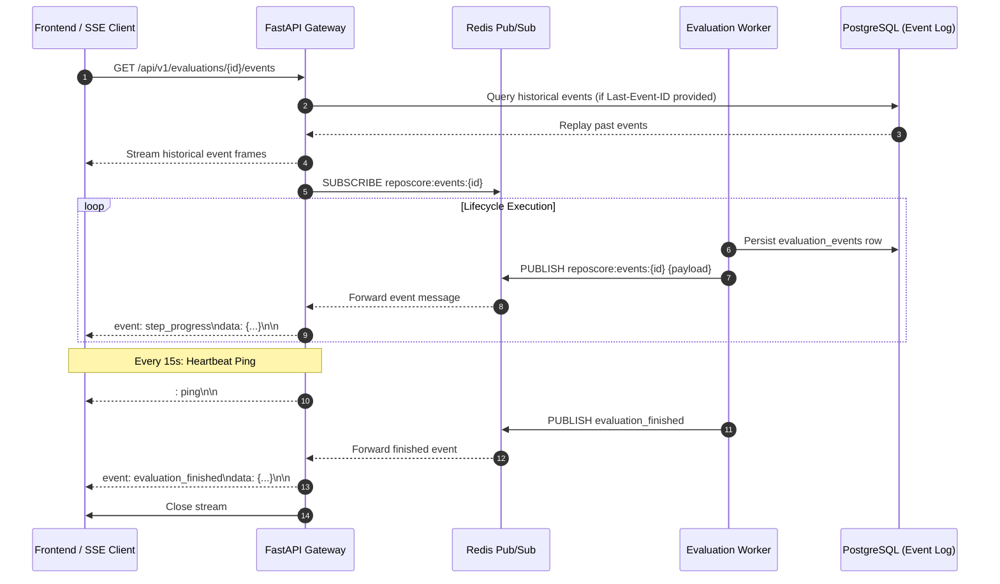

# Server-Sent Events (SSE) Real-Time Streaming Specification

> **Document:** `EVENT_STREAM_SPEC.md`  
> **System:** RepoScore — Autonomous Repository Intelligence & Software Evaluation Engine  
> **Status:** Active / API Contract Baseline  
> **Authority:** [`docs/architecture/SYSTEM_ARCHITECTURE.md`](file:///c:/Partition/SERIOUS%20PROJECTS/REPO-Score/docs/architecture/SYSTEM_ARCHITECTURE.md), [`AGENTS.md`](file:///c:/Partition/SERIOUS%20PROJECTS/REPO-Score/AGENTS.md)

---

## 1. Overview & Protocol Architecture

RepoScore exposes real-time evaluation progress via **Server-Sent Events (SSE)** at `GET /api/v1/evaluations/{id}/events`.
- **Protocol:** HTTP/1.1 or HTTP/2 persistent streaming (`text/event-stream`).
- **Connection Headers:**
  - `Content-Type: text/event-stream; charset=utf-8`
  - `Cache-Control: no-cache, no-transform`
  - `Connection: keep-alive`
  - `X-Accel-Buffering: no` (disables Nginx/reverse-proxy buffering)
- **Pub/Sub Transport:** Evaluation workers publish event JSON payloads to Redis Pub/Sub channel `reposcore:events:{evaluation_id}`. The API gateway subscribes to the channel and streams formatted event frames to connected HTTP clients.



---

## 2. Event Frame Format & Catalog

All event frames conform to the W3C SSE standard:
```text
id: {event_id}
event: {event_name}
retry: 3000
data: {json_payload}

```

### 2.1 Event Catalog

| Event Name | Trigger Condition | Payload Key Fields |
|---|---|---|
| `state_transition` | Evaluation status changes | `from_status`, `to_status`, `timestamp` |
| `step_started` | New pipeline step begins | `step_name`, `step_index`, `total_steps` |
| `step_progress` | Intermediate step execution update | `step_name`, `percent`, `message`, `elapsed_ms` |
| `step_completed` | Pipeline step finishes successfully | `step_name`, `status`, `duration_ms`, `exit_code` |
| `evidence_discovered` | Analyzer or probe emits normalized evidence | `evidence_id`, `category`, `severity`, `title` |
| `evaluation_finished` | Terminal state reached | `final_status`, `overall_score`, `grade`, `total_duration_ms` |
| `evaluation_failed` | Catastrophic failure occurred | `failure_class`, `error_message`, `exit_code` |
| `ping` | Periodic keep-alive heartbeat | Empty comment or timestamp (`: ping`) |

---

## 3. Sample Event Payloads

### 3.1 `step_progress` Frame
```text
id: 01925b4a-a001-7000-8000-000000000001
event: step_progress
retry: 3000
data: {"step":"BUILDING","percent":45,"message":"Running pip install -r requirements.txt inside sandbox...","elapsed_ms":12400}

```

### 3.2 `evidence_discovered` Frame
```text
id: 01925b4a-a002-7000-8000-000000000002
event: evidence_discovered
retry: 3000
data: {"evidence_id":"01925b4a-e011-7000-8000-000000000001","category":"SECURITY","severity":"HIGH","title":"Insecure eval() detected","file_path":"backend/app.py","line":42}

```

### 3.3 `evaluation_finished` Frame
```text
id: 01925b4a-a003-7000-8000-000000000003
event: evaluation_finished
retry: 3000
data: {"evaluation_id":"01925b4a-8cf2-7612-882f-3d18c9ba1100","final_status":"COMPLETED","overall_score":88.5,"grade":"A","total_duration_ms":145200}

```

---

## 4. Reconnection & Stream Replay

1. **Client Disconnection Handling:** If the client disconnects (network flicker, tab reload), the browser sends the `Last-Event-ID` request header on reconnect:
   `Last-Event-ID: 01925b4a-a002-7000-8000-000000000002`
2. **PostgreSQL Event Replay:**
   - The API gateway queries `evaluation_events` where `evaluation_id = {id}` and `id > Last-Event-ID` ordered by `emitted_at ASC`.
   - The API replays missed events before streaming live Redis Pub/Sub events.
3. **Heartbeat Protocol:**
   - Every 15 seconds of inactivity, the gateway writes a comment frame `: ping\n\n` to prevent reverse proxies (e.g. AWS ALB, Cloudflare) from terminating idle connections.
