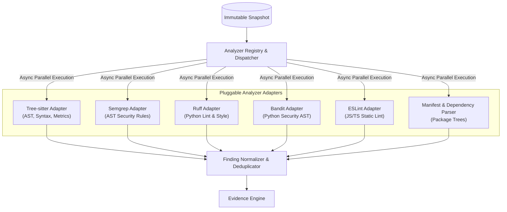
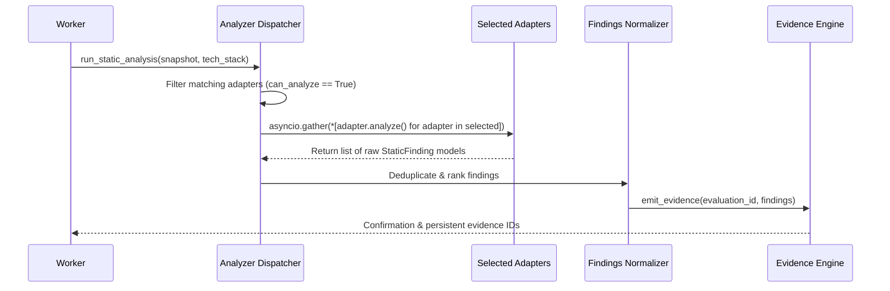

# Static Analyzer Architecture

> **Document:** `ANALYZER_ARCHITECTURE.md`  
> **Status:** Active / Architectural Contract  
> **Owner:** Core Architecture Team  
> **Referenced ADRs:** ADR-003, ADR-008

---

## 1. Architectural Goals & Adapter Model

Static analysis in RepoScore serves to inspect code structure, complexity, maintainability, architectural conventions, and static security vulnerabilities without executing untrusted code on the host.

To avoid vendor lock-in and allow seamless additions of new tools, all static analysis tools are implemented as **isolated adapters** behind a unified, language-agnostic interface.



---

## 2. Core Analyzer Abstractions

Every analyzer adapter must inherit from `BaseAnalyzer` and adhere to the strict typing contract:

```python
from abc import ABC, abstractmethod
from pathlib import Path
from pydantic import BaseModel
from enum import Enum

class AnalyzerCategory(str, Enum):
    SYNTAX_METRICS = "SYNTAX_METRICS"
    SECURITY = "SECURITY"
    CODE_QUALITY = "CODE_QUALITY"
    DEPENDENCY = "DEPENDENCY"
    TEST_STRUCTURE = "TEST_STRUCTURE"
    ARCHITECTURE = "ARCHITECTURE"

class Severity(str, Enum):
    INFO = "INFO"
    LOW = "LOW"
    MEDIUM = "MEDIUM"
    HIGH = "HIGH"
    CRITICAL = "CRITICAL"

class StaticFinding(BaseModel):
    analyzer_id: str
    rule_id: str
    category: AnalyzerCategory
    severity: Severity
    file_path: str
    start_line: int
    end_line: int
    start_column: int | None = None
    end_column: int | None = None
    message: str
    snippet: str | None = None
    remediation_hint: str | None = None
    cwe_id: str | None = None
    raw_output: dict | None = None

class BaseAnalyzer(ABC):
    name: str
    version: str
    category: AnalyzerCategory
    target_languages: list[str]

    @abstractmethod
    def can_analyze(self, tech_stack: dict) -> bool:
        """Determines if the analyzer should run for the detected project technologies."""
        pass

    @abstractmethod
    async def analyze(self, snapshot_path: Path, context: dict) -> list[StaticFinding]:
        """Executes the analysis tool against snapshot files and returns normalized findings."""
        pass
```

---

## 3. Tool Implementations & Responsibilities

### 3.1 Tree-sitter AST & Syntax Engine
- **Purpose**: Fast, robust concrete syntax tree parsing across 40+ programming languages.
- **Metrics Collected**:
  - Total Lines of Code (LOC), Source Lines of Code (SLOC), Blank Lines, Comment Lines.
  - Cyclomatic Complexity per function and class.
  - Cognitive Complexity scores.
  - Comment-to-code ratio and public API docstring coverage percentage.
  - Function length distribution and parameter count violations.

### 3.2 Semgrep Security & Bug Pattern Engine
- **Purpose**: Semantic pattern matching against ASTs to find critical security vulnerabilities and anti-patterns.
- **Rule Packs (Free / Open Source)**:
  - OWASP Top 10 rules (SQL injection, SSRF, Path traversal, Insecure deserialization).
  - Hardcoded secrets and insecure cryptographic primitives.
  - Race conditions, unhandled exceptions, resource leaks.

### 3.3 Language-Specific Linters (Ruff / ESLint)
- **Ruff (Python)**:
  - Executes in milliseconds over thousands of Python files.
  - Detects syntax errors, import anomalies, unused variables, formatting violations, and deprecated API usages.
- **ESLint / TypeScript Engine**:
  - Analyzes JavaScript/TypeScript repositories for type safety, unsafe `any` usages, unhandled Promise rejections, and DOM XSS vulnerabilities.

### 3.4 Architecture & Dependency Graph Analyzer
- **Purpose**: Analyzes modularity, package structure, and internal dependency coupling.
- **Capabilities**:
  - Builds the directed graph of internal module imports.
  - Detects circular dependencies (e.g., Module A $\to$ Module B $\to$ Module A).
  - Flags layer violations (e.g., Domain models importing UI rendering components or API routes).

---

## 4. Execution & Orchestration Engine



### Execution Invariants:
1. **Host Safety**: Tree-sitter and native AST parsers run in isolated worker Python processes. External CLI tools (Semgrep, Ruff) execute inside unprivileged ephemeral sandbox containers or restricted sandboxed sub-processes with disabled networking.
2. **Deterministic Outputs**: Given the identical repository snapshot and analyzer ruleset version, findings must be strictly identical across repeated runs.
3. **Resilience**: If one analyzer crashes or encounters a syntax parse failure, it emits an `ANALYZER_WARNING` finding. It **never** causes the entire evaluation pipeline to fail.
