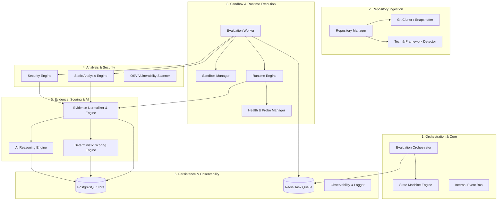

# Component Architecture

> **Document:** `COMPONENT_ARCHITECTURE.md`  
> **Status:** Active / Architectural Contract  
> **Owner:** Core Architecture Team  
> **Referenced ADRs:** ADR-001, ADR-008, ADR-009

---

## 1. Subsystem & Component Decomposition

The RepoScore backend is structured as a **clean, modular monolith**. Each domain component is isolated within its own package under `backend/`, exposing well-defined Python interfaces and typed Pydantic models. Cross-domain interactions occur strictly via explicit interfaces or message events.



---

## 2. Component Specifications

### 2.1 Repository Ingestion (`backend/repository`)

#### Responsibilities:
- Validate and normalize target repository URLs (GitHub HTTPS / SSH).
- Execute shallow or sparse git clones up to configurable depth limits (default: depth 50).
- Extract immutable Git metadata: Commit SHA, tree hash, author details, branch names, tags, and license.
- Generate an immutable, read-only snapshot directory containing repository source files.
- Inspect file trees to automatically detect primary languages, package manifests, build scripts, frameworks, and probable entry points.

#### Key Interfaces:
```python
class IRepositoryManager(Protocol):
    async def ingest_repository(self, repo_url: str, ref: str | None = None) -> RepositorySnapshot:
        """Clones and generates an immutable snapshot of the repository."""
        ...

    async def detect_technologies(self, snapshot_path: Path) -> TechnologyStack:
        """Inspects snapshot files to discover languages, build tools, and frameworks."""
        ...
```

---

### 2.2 Evaluation Orchestrator & Workers (`backend/orchestration`, `backend/workers`)

#### Responsibilities:
- Owns the end-to-end evaluation lifecycle and transition invariants.
- Enqueues evaluation tasks into Redis queues with deterministic job IDs and correlation tracking.
- Distributed workers consume tasks, instantiate sandbox environments, and execute pipeline stages sequentially.
- Enforces stage timeouts (e.g., maximum 5 minutes for build, 3 minutes for runtime probing).
- Handles cancellation signals gracefully by terminating running sandboxes and updating database records.

#### Key Interfaces:
```python
class IEvaluationOrchestrator(Protocol):
    async def create_evaluation(self, repo_id: UUID, commit_sha: str) -> EvaluationRecord:
        """Initializes a new evaluation record and queues work."""
        ...

    async def cancel_evaluation(self, evaluation_id: UUID, reason: str) -> None:
        """Signals active workers to terminate sandbox execution."""
        ...

class IEvaluationWorker(Protocol):
    async def process_task(self, task_payload: EvaluationTask) -> EvaluationResult:
        """Executes the analysis and runtime pipeline for a queued task."""
        ...
```

---

### 2.3 Sandbox Manager (`backend/sandbox`)

#### Responsibilities:
- Programmatic lifecycle management of ephemeral Docker containers via the Docker Engine API.
- Configures kernel sandboxing primitives:
  - Memory limit (e.g., 2GB hard ceiling, 512MB swap).
  - CPU quota (e.g., 2 cores, `cpushares=1024`).
  - PID limits (`pids-limit=256`) to thwart fork bombs.
  - Security profile: `--security-opt=no-new-privileges:true`, `--cap-drop=ALL`.
  - Non-root user execution (`uid=10001`, `gid=10001`).
  - Read-only root filesystem with isolated ephemeral tmpfs mounts for `/tmp` and build output.
  - Strict network namespace isolation.
- Captures multiplexed container stdout/stderr streams and exports real-time resource utilization (CPU, memory, disk I/O).

#### Key Interfaces:
```python
class ISandboxManager(Protocol):
    async def create_sandbox(self, config: SandboxConfig) -> SandboxHandle:
        """Creates an isolated container execution context with strict constraints."""
        ...

    async def execute_command(
        self,
        sandbox_id: str,
        command: list[str],
        timeout_seconds: int,
        env_vars: dict[str, str] | None = None,
    ) -> ExecutionResult:
        """Runs a command inside the sandbox, streaming output and capturing return codes."""
        ...

    async def terminate_sandbox(self, sandbox_id: str, force: bool = False) -> None:
        """Kills processes, removes container instances, and purges temporary mounts."""
        ...
```

---

### 2.4 Static & Security Analysis Engines (`backend/analyzers`, `backend/security`)

#### Responsibilities:
- Common adapter interface wrapping heterogeneous static analysis and linting tools.
- Concrete adapters for:
  - **Tree-sitter**: Abstract syntax tree parsing, language metrics, function complexity, comment density.
  - **Semgrep**: AST-based rule engine detecting antipatterns and security flaws.
  - **Ruff / Bandit**: Fast linting, code style, and security vulnerability detection for Python.
  - **OSV Client**: Queries the Open Source Vulnerabilities database for package CVEs matching `requirements.txt`, `package.json`, `go.mod`, `Cargo.lock`, etc.
  - **Secret Detection Adapter**: High-entropy regex pattern scanner to catch hard-coded API tokens, private keys, and passwords.
- Outputs standardized finding objects containing file locations, severity levels, and CVE references.

#### Key Interfaces:
```python
class IAnalyzer(Protocol):
    name: str
    version: str
    target_languages: list[str]

    async def analyze(self, snapshot_path: Path, context: AnalysisContext) -> list[StaticFinding]:
        """Performs static analysis over snapshot sources and returns findings."""
        ...

class ISecurityEngine(Protocol):
    async def scan_dependencies(self, manifests: list[ManifestFile]) -> list[SecurityFinding]:
        """Cross-references declared dependencies with vulnerability feeds."""
        ...

    async def scan_code_secrets(self, snapshot_path: Path) -> list[SecurityFinding]:
        """Scans codebase for leaked credentials and critical anti-patterns."""
        ...
```

---

### 2.5 Runtime Engine (`backend/runtime`)

#### Responsibilities:
- Analyzes repository metadata to identify execution strategy:
  - **REST API / Web Service**: Starts application, waits for port listening, executes health check probes, tests OpenAPI/Swagger specifications, and runs synthetic HTTP traffic.
  - **CLI Application**: Runs `--help`, `--version`, and argument permutations to verify exit codes and help output.
  - **Library / Package**: Builds artifacts, executes unit test suites (e.g., `pytest`, `npm test`, `cargo test`), and inspects code coverage reports.
  - **Worker / Background Process**: Verifies startup, processes simulated queue messages, and checks graceful termination on SIGTERM.
- Collects runtime metrics: cold start latency, memory footprint during idle and load, unhandled exceptions, and stderr warnings.

#### Key Interfaces:
```python
class IRuntimeEngine(Protocol):
    async def build(self, sandbox: SandboxHandle, strategy: BuildStrategy) -> BuildResult:
        """Executes compilation and packaging within the sandbox."""
        ...

    async def start_and_observe(
        self,
        sandbox: SandboxHandle,
        strategy: RuntimeStrategy,
        duration_seconds: int,
    ) -> RuntimeObservation:
        """Launches target service, performs synthetic interactions, and monitors telemetry."""
        ...
```

---

### 2.6 Evidence Engine (`backend/evidence`)

#### Responsibilities:
- Central clearinghouse for all observations, static findings, runtime metrics, and security warnings.
- Normalizes disparate tool outputs into a unified schema:
  - UUID, evaluation ID, source analyzer, severity, confidence, code location, raw payload, normalized attributes.
- Implements immutable evidence persistence to PostgreSQL.
- Serves as the strictly required input substrate for both the Scoring Engine and the AI Reasoner.

#### Key Interfaces:
```python
class IEvidenceEngine(Protocol):
    async def record_evidence(self, evaluation_id: UUID, findings: list[RawFinding]) -> list[EvidenceRecord]:
        """Normalizes and persists structured evidence entries."""
        ...

    async def get_evidence_by_evaluation(
        self,
        evaluation_id: UUID,
        category: EvidenceCategory | None = None,
    ) -> list[EvidenceRecord]:
        """Retrieves verified evidence records for scoring and reporting."""
        ...
```

---

### 2.7 Deterministic Scoring Engine (`backend/scoring`)

#### Responsibilities:
- Computes multi-dimensional scores on a normalized 0 to 100 scale using strictly deterministic, rule-based algorithms.
- Evaluates 10 independent dimensions:
  1. Correctness
  2. Reliability
  3. Security
  4. Maintainability
  5. Testing
  6. Documentation
  7. Performance
  8. Architecture
  9. Dependency Health
  10. Engineering Maturity
- Produces an explainable breakdown: each dimension score is accompanied by the exact formula, applied penalties, positive credits, and links to supporting evidence UUIDs.
- Strictly deterministic: identical evidence records yield the exact same score. AI has zero influence on the numerical score.

#### Key Interfaces:
```python
class IScoringEngine(Protocol):
    def calculate_dimension_scores(self, evidence: list[EvidenceRecord]) -> ScoreCard:
        """Calculates deterministic dimension scores and overall weighted score."""
        ...
```

---

### 2.8 AI Reasoning Engine (`backend/ai`)

#### Responsibilities:
- Ingests structured evidence records, test output summaries, and code architecture summaries.
- Interacts with local-first LLM instances (Ollama / vLLM) via an abstract provider interface.
- Synthesizes human-readable insights:
  - Executive summary and architectural assessment.
  - Root-cause explanations for build or runtime failures.
  - Actionable recommendations prioritized by engineering impact.
- Enforces strict prompt hygiene, token budget ceilings, schema validation via Pydantic on structured JSON outputs, and absolute isolation from numeric scoring.

#### Key Interfaces:
```python
class IAIReasoner(Protocol):
    async def generate_evaluation_summary(
        self,
        scorecard: ScoreCard,
        evidence: list[EvidenceRecord],
    ) -> AIAnalysisResult:
        """Generates narrative architectural insights and remediation recommendations."""
        ...
```
