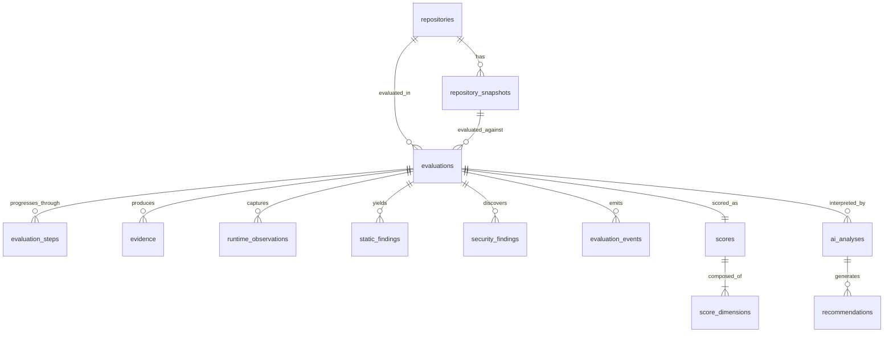

# Database Architecture & Relational Schema

> **Document:** `DATABASE_ARCHITECTURE.md`  
> **Status:** Active / Architectural Contract  
> **Owner:** Data Architecture Team  
> **Referenced ADRs:** ADR-006, ADR-010

---

## 1. Database Overview & Design Principles

RepoScore relies on **PostgreSQL 16+** as its single, unified relational and document datastore.
1. **Relational Rigour**: Core operational entities (Repositories, Snapshots, Evaluations, Evaluation Steps, Scores) maintain strict foreign key relationships, cascade semantics, and transactional integrity.
2. **Semi-Structured Flexibility**: Telemetry, findings, tool outputs, and AST metadata leverage PostgreSQL `JSONB` columns with GIN indexes.
3. **Immutability of Evaluation Artifacts**: Snapshots, evidence, raw metrics, and calculated scores are append-only. Once an evaluation is sealed, these records are never updated or deleted.

---

## 2. Entity-Relationship Model



---

## 3. Physical DDL Specifications

```sql
-- Repositories Table
CREATE TABLE repositories (
    id UUID PRIMARY KEY DEFAULT gen_random_uuid(),
    url VARCHAR(512) NOT NULL UNIQUE,
    provider VARCHAR(32) NOT NULL DEFAULT 'github',
    owner VARCHAR(128) NOT NULL,
    name VARCHAR(128) NOT NULL,
    default_branch VARCHAR(64) DEFAULT 'main',
    is_private BOOLEAN NOT NULL DEFAULT FALSE,
    created_at TIMESTAMPTZ NOT NULL DEFAULT NOW(),
    updated_at TIMESTAMPTZ NOT NULL DEFAULT NOW()
);

-- Repository Snapshots (Immutable commit reference)
CREATE TABLE repository_snapshots (
    id UUID PRIMARY KEY DEFAULT gen_random_uuid(),
    repository_id UUID NOT NULL REFERENCES repositories(id) ON DELETE CASCADE,
    commit_sha CHAR(40) NOT NULL,
    tree_hash CHAR(64) NOT NULL,
    branch_or_tag VARCHAR(128),
    storage_path VARCHAR(512) NOT NULL,
    detected_languages JSONB NOT NULL DEFAULT '{}',
    detected_frameworks JSONB NOT NULL DEFAULT '[]',
    detected_entrypoints JSONB NOT NULL DEFAULT '[]',
    created_at TIMESTAMPTZ NOT NULL DEFAULT NOW(),
    CONSTRAINT uq_repo_commit UNIQUE (repository_id, commit_sha)
);

-- Evaluations Master Record
CREATE TABLE evaluations (
    id UUID PRIMARY KEY DEFAULT gen_random_uuid(),
    repository_id UUID NOT NULL REFERENCES repositories(id) ON DELETE CASCADE,
    snapshot_id UUID NOT NULL REFERENCES repository_snapshots(id),
    status VARCHAR(32) NOT NULL DEFAULT 'QUEUED',
    correlation_id UUID NOT NULL,
    trigger_source VARCHAR(32) NOT NULL DEFAULT 'MANUAL',
    worker_id VARCHAR(64),
    started_at TIMESTAMPTZ,
    completed_at TIMESTAMPTZ,
    error_summary TEXT,
    created_at TIMESTAMPTZ NOT NULL DEFAULT NOW()
);

-- Step Progress Audit Log
CREATE TABLE evaluation_steps (
    id UUID PRIMARY KEY DEFAULT gen_random_uuid(),
    evaluation_id UUID NOT NULL REFERENCES evaluations(id) ON DELETE CASCADE,
    step_name VARCHAR(64) NOT NULL,
    status VARCHAR(32) NOT NULL,
    started_at TIMESTAMPTZ NOT NULL,
    completed_at TIMESTAMPTZ,
    duration_ms INTEGER,
    exit_code INTEGER,
    error_message TEXT,
    metadata JSONB DEFAULT '{}'
);

-- Normalized Evidence (Append-Only)
CREATE TABLE evidence (
    id UUID PRIMARY KEY DEFAULT gen_random_uuid(),
    evaluation_id UUID NOT NULL REFERENCES evaluations(id) ON DELETE CASCADE,
    source VARCHAR(64) NOT NULL,
    category VARCHAR(32) NOT NULL,
    severity VARCHAR(16) NOT NULL,
    confidence REAL NOT NULL CHECK (confidence >= 0.0 AND confidence <= 1.0),
    fingerprint CHAR(64) NOT NULL,
    title VARCHAR(255) NOT NULL,
    description TEXT NOT NULL,
    location JSONB,
    raw_payload JSONB,
    normalized_attributes JSONB,
    related_evidence_ids UUID[] DEFAULT '{}',
    created_at TIMESTAMPTZ NOT NULL DEFAULT NOW(),
    CONSTRAINT uq_eval_fingerprint UNIQUE (evaluation_id, fingerprint)
);

-- Deterministic Scores
CREATE TABLE scores (
    id UUID PRIMARY KEY DEFAULT gen_random_uuid(),
    evaluation_id UUID NOT NULL UNIQUE REFERENCES evaluations(id) ON DELETE CASCADE,
    scoring_version VARCHAR(16) NOT NULL DEFAULT '1.0.0',
    overall_score NUMERIC(5, 2) NOT NULL CHECK (overall_score >= 0.0 AND overall_score <= 100.0),
    grade VARCHAR(4) NOT NULL,
    created_at TIMESTAMPTZ NOT NULL DEFAULT NOW()
);

-- Dimension Sub-Scores
CREATE TABLE score_dimensions (
    id UUID PRIMARY KEY DEFAULT gen_random_uuid(),
    score_id UUID NOT NULL REFERENCES scores(id) ON DELETE CASCADE,
    dimension_name VARCHAR(32) NOT NULL,
    score NUMERIC(5, 2) NOT NULL CHECK (score >= 0.0 AND score <= 100.0),
    weight NUMERIC(4, 3) NOT NULL,
    itemized_receipt JSONB NOT NULL DEFAULT '[]',
    created_at TIMESTAMPTZ NOT NULL DEFAULT NOW(),
    CONSTRAINT uq_score_dimension UNIQUE (score_id, dimension_name)
);

-- AI Narrative Analysis
CREATE TABLE ai_analyses (
    id UUID PRIMARY KEY DEFAULT gen_random_uuid(),
    evaluation_id UUID NOT NULL UNIQUE REFERENCES evaluations(id) ON DELETE CASCADE,
    provider VARCHAR(32) NOT NULL,
    model_name VARCHAR(64) NOT NULL,
    executive_summary TEXT NOT NULL,
    architectural_assessment TEXT NOT NULL,
    runtime_failure_root_cause TEXT,
    security_risk_narrative TEXT NOT NULL,
    tokens_consumed INTEGER,
    created_at TIMESTAMPTZ NOT NULL DEFAULT NOW()
);

-- AI Actionable Recommendations
CREATE TABLE recommendations (
    id UUID PRIMARY KEY DEFAULT gen_random_uuid(),
    ai_analysis_id UUID NOT NULL REFERENCES ai_analyses(id) ON DELETE CASCADE,
    title VARCHAR(255) NOT NULL,
    category VARCHAR(32) NOT NULL,
    priority VARCHAR(16) NOT NULL,
    explanation TEXT NOT NULL,
    actionable_steps JSONB NOT NULL DEFAULT '[]',
    related_evidence_ids UUID[] DEFAULT '{}',
    created_at TIMESTAMPTZ NOT NULL DEFAULT NOW()
);

-- Real-time Audit Events Log
CREATE TABLE evaluation_events (
    id UUID PRIMARY KEY DEFAULT gen_random_uuid(),
    evaluation_id UUID NOT NULL REFERENCES evaluations(id) ON DELETE CASCADE,
    event_type VARCHAR(64) NOT NULL,
    payload JSONB NOT NULL DEFAULT '{}',
    emitted_at TIMESTAMPTZ NOT NULL DEFAULT NOW()
);
```
