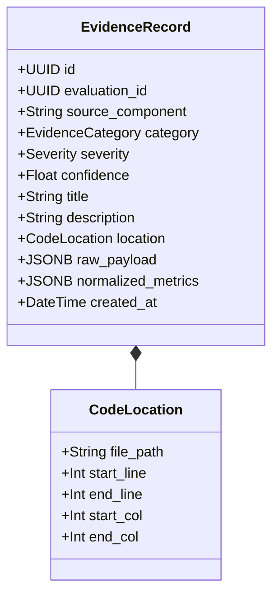
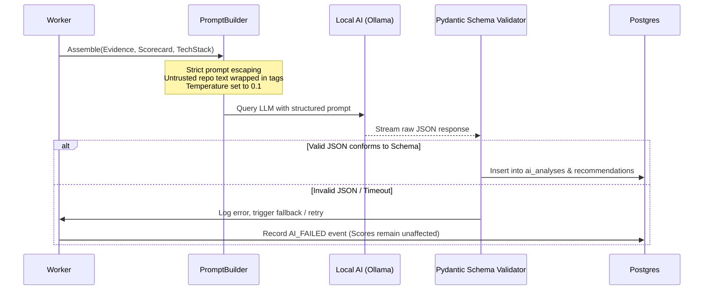

# Data Flow Architecture

> **Document:** `DATA_FLOW.md`  
> **Status:** Active / Architectural Contract  
> **Owner:** Core Architecture Team  
> **Referenced ADRs:** ADR-003, ADR-006, ADR-010

---

## 1. End-to-End Data Pipeline

The RepoScore data flow transforms an untrusted external repository URL into an immutable evaluation report through sequential, deterministic, and verifiable stages.

```mermaid
flowchart TD
    subgraph Stage1 ["Stage 1: Repository Ingestion"]
        InURL[Target Repository URL] --> IngestValidate{Validate URL & Permissions}
        IngestValidate -->|Valid| GitClone[Git Clone / Fetch Snapshot]
        GitClone --> Snapshot[(Immutable Disk Snapshot)]
        Snapshot --> SnapshotMeta[(Postgres: repository_snapshots)]
    end

    subgraph Stage2 ["Stage 2: Static & Security Analysis"]
        Snapshot --> TechDetect[Technology & Entrypoint Detection]
        TechDetect --> ASTParse[AST Analysis (Tree-sitter)]
        TechDetect --> StaticLint[Linters (Ruff / ESLint / Bandit)]
        TechDetect --> RuleScan[Security Scan (Semgrep)]
        TechDetect --> VulnScan[Dependency Scan (OSV Engine)]
        ASTParse --> RawFindings[Raw Findings Stream]
        StaticLint --> RawFindings
        RuleScan --> RawFindings
        VulnScan --> RawFindings
    end

    subgraph Stage3 ["Stage 3: Sandboxed Execution & Observation"]
        Snapshot --> SandboxBuild[Sandboxed Compilation / Build]
        SandboxBuild -->|Success| SandboxRun[Sandboxed Runtime Execution]
        SandboxRun --> Probing[Synthetic Probes / Tests / CLI Probes]
        SandboxRun --> Telemetry[Resource Telemetry (CPU/RAM/IO)]
        Probing --> RawRuntimeLogs[Runtime Output & Health Metrics]
        Telemetry --> RawRuntimeLogs
    end

    subgraph Stage4 ["Stage 4: Evidence Normalization"]
        RawFindings --> EvidenceEngine[Evidence Normalizer]
        RawRuntimeLogs --> EvidenceEngine
        EvidenceEngine --> EvidenceDB[(Postgres: evidence)]
    end

    subgraph Stage5 ["Stage 5: Scoring & AI Synthesis"]
        EvidenceDB --> ScoringEngine[Deterministic Scoring Engine]
        ScoringEngine --> ScoreDB[(Postgres: scores & dimensions)]
        EvidenceDB --> PromptBuilder[Prompt Sanitization & Assembly]
        ScoreDB --> PromptBuilder
        PromptBuilder --> AIProvider[Local AI Reasoner (Ollama)]
        AIProvider --> AIAnalysisDB[(Postgres: ai_analyses & recommendations)]
    end

    subgraph Stage6 ["Stage 6: Client Delivery"]
        ScoreDB --> APIResponse[FastAPI Serializer]
        AIAnalysisDB --> APIResponse
        EvidenceDB --> APIResponse
        APIResponse --> Frontend[Next.js Presentation Dashboard]
    end
```

---

## 2. Detailed Data Transformation Stages

### 2.1 Ingestion & Snapshot Generation
1. **Input Payload**: `POST /repositories/evaluate`
   ```json
   {
     "repo_url": "https://github.com/example/sample-service.git",
     "ref": "main",
     "options": {
       "depth": 50,
       "timeout_seconds": 600
     }
   }
   ```
2. **Snapshot Creation**:
   - Clones git tree into an isolated directory: `/var/data/snapshots/{repo_id}/{commit_sha}/`.
   - Generates a SHA-256 tree checksum verifying filesystem integrity.
   - Sets filesystem permissions to read-only (`0555`) to guarantee absolute immutability.
   - Inserts record into `repository_snapshots` table.

---

### 2.2 Static Analysis & Evidence Collection
- Each analyzer adapter runs against the immutable snapshot directory.
- Analyzers produce strongly-typed intermediate finding models:
  ```json
  {
    "analyzer": "semgrep",
    "rule_id": "python.security.insecure-hash.md5",
    "file_path": "auth/tokens.py",
    "line_start": 42,
    "line_end": 42,
    "severity": "HIGH",
    "message": "Use of weak cryptographic hash MD5 detected"
  }
  ```
- Findings are routed to the **Evidence Engine**, which maps them into canonical `evidence` records.

---

### 2.3 Sandboxed Execution & Runtime Telemetry
1. **Sandbox Spawning**:
   - The Sandbox Manager creates an isolated container utilizing a curated base runtime image (e.g., `reposcore/runner-python:3.12` or `reposcore/runner-node:20`).
   - The repository snapshot is mounted as a read-only base volume; build targets write to an ephemeral `tmpfs` scratch space.
2. **Build Stage Data**:
   - Command exit codes, standard output, standard error, duration, and disk artifacts are recorded.
   - Any failure emits a structured `BUILD_FAILED` evidence entry.
3. **Runtime & Probing Data**:
   - For web services: Time-to-listen, response latencies (p50, p95, p99), HTTP status codes, error rate under 10 concurrent requests.
   - For CLI tools: Exit codes, argument parsing adherence, `--help` formatting.
   - For libraries: Test suite runner output (tests passed, failed, skipped), code coverage percentage.
   - Telemetry poller records CPU quota usage and memory peak consumption every 500ms.

---

### 2.4 Evidence Normalization Pipeline
The Evidence Engine enforces a strict schema for all data entering persistence:



- **Immutability Guarantee**: Once written to the database, an `EvidenceRecord` cannot be edited or deleted. It forms an immutable audit trail.

---

### 2.5 Deterministic Scoring Flow
1. **Evidence Query**: The Scoring Engine queries all `evidence` rows associated with the `evaluation_id`.
2. **Metric Aggregation**: Groups evidence by category (e.g., `CORRECTNESS`, `SECURITY`, `MAINTAINABILITY`).
3. **Rule Evaluation**: Computes dimension sub-scores on a 0–100 scale using transparent mathematical functions:
   $$\text{DimensionScore} = \text{Clamp}_{0}^{100}\left(\text{BaseScore} - \sum \text{Penalties} + \sum \text{Credits}\right)$$
4. **Composite Score**: Calculates the final overall score as a weighted average across all 10 dimensions.
5. **Score Persistence**: Inserts score records into `scores` and `score_dimensions` tables.

---

### 2.6 AI Synthesis Flow


---

## 3. Data Integrity & Retention Rules

1. **Deterministic Reproducibility**: Given the same repository snapshot and tool versions, the static analysis, dependency scan, and scoring engine MUST produce the identical scorecard.
2. **No Data Loss on Worker Crash**: Workers commit step state transitions to PostgreSQL atomically before proceeding to subsequent stages.
3. **Audit Trail**: Every evaluation execution records state transition timestamps, worker hostname, tool versions, and raw container exit statuses.
4. **Snapshot Lifecycle**: Disk snapshots of public repositories are retained during evaluation and cached for 24 hours to accelerate repeated evaluations, after which they are reclaimed by the storage garbage collector.
