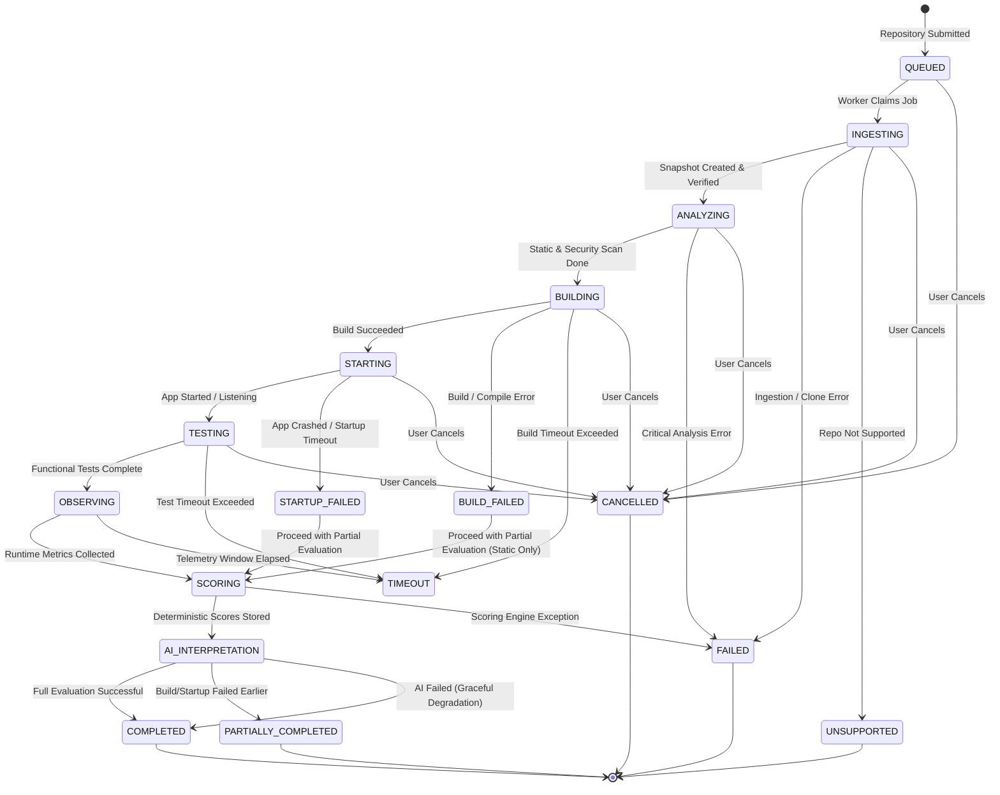

# Evaluation Lifecycle & State Machine

> **Document:** `EVALUATION_LIFECYCLE.md`  
> **Status:** Active / Architectural Contract  
> **Owner:** Core Architecture Team  
> **Referenced ADRs:** ADR-001, ADR-007

---

## 1. Lifecycle State Machine

An evaluation progresses through a finite, deterministic set of discrete states. All state changes are strictly synchronous, atomic, and recorded in the database audit log. No implicit or unrecorded state transitions are permitted.

---

## 2. Complete State Catalog

| State | Category | Description | Permitted Next States |
|---|---|---|---|
| `QUEUED` | Pending | Evaluation record created; waiting in Redis queue for available worker. | `INGESTING`, `CANCELLED` |
| `INGESTING` | Active | Worker is validating URL, shallow-cloning git repo, and creating immutable disk snapshot. | `ANALYZING`, `FAILED`, `UNSUPPORTED`, `CANCELLED` |
| `ANALYZING` | Active | Running static analyzers (Tree-sitter, Semgrep, linters) and dependency vulnerability scans (OSV). | `BUILDING`, `FAILED`, `CANCELLED` |
| `BUILDING` | Active | Sandboxed Docker container building dependencies and compiling code. | `STARTING`, `BUILD_FAILED`, `TIMEOUT`, `CANCELLED` |
| `STARTING` | Active | Launching target application or service in sandbox; waiting for health check or port readiness. | `TESTING`, `STARTUP_FAILED`, `CANCELLED` |
| `TESTING` | Active | Executing synthetic test requests, CLI invocations, or running automated unit test suites. | `OBSERVING`, `TIMEOUT`, `CANCELLED` |
| `OBSERVING` | Active | Collecting CPU, RAM, disk I/O metrics, error rates, and connection behaviors during execution. | `SCORING`, `TIMEOUT` |
| `SCORING` | Active | Deterministic calculation of 10 evaluation dimensions and overall score from collected evidence. | `AI_INTERPRETATION`, `FAILED` |
| `AI_INTERPRETATION` | Active | Local AI provider synthesizes narrative summary, root-cause analyses, and recommendations. | `COMPLETED`, `PARTIALLY_COMPLETED` |
| `COMPLETED` | Terminal | Full evaluation succeeded across all stages (static, build, runtime, scoring, AI). | *Terminal* |
| `PARTIALLY_COMPLETED` | Terminal | Execution completed partially (e.g. build or startup failed, but static analysis & partial scores exist). | *Terminal* |
| `BUILD_FAILED` | Intermediate | Code failed compilation or package installation; routes to partial scoring. | `SCORING` |
| `STARTUP_FAILED` | Intermediate | Application failed to boot, crashed immediately, or failed health checks; routes to partial scoring. | `SCORING` |
| `FAILED` | Terminal | Catastrophic infrastructure, worker, or unrecoverable system failure. | *Terminal* |
| `TIMEOUT` | Terminal | Overall evaluation or specific critical step exceeded max allowed execution duration. | `SCORING`, `FAILED` |
| `CANCELLED` | Terminal | Explicit cancellation requested by client or administrative operator. | *Terminal* |
| `UNSUPPORTED` | Terminal | Repository contains no recognizable code, is empty, or exceeds allowed limits. | *Terminal* |

---

## 3. Transition Invariants & Rules

1. **State Immutability of Terminal States**: Once an evaluation reaches a terminal state (`COMPLETED`, `PARTIALLY_COMPLETED`, `FAILED`, `CANCELLED`, `UNSUPPORTED`), its status can never transition to any other state.
2. **Step Audit Trail**: Every state transition creates an entry in `evaluation_steps`:
   - `step_name`: string (e.g., `BUILDING`)
   - `started_at`: timestamp
   - `completed_at`: timestamp
   - `status`: `SUCCESS`, `FAILURE`, `SKIPPED`
   - `error_message`: optional sanitized error string
   - `exit_code`: container or process return code
3. **Graceful Partial Scoring**: If a repository fails to build (`BUILD_FAILED`) or crashes on startup (`STARTUP_FAILED`), the evaluation is **not** aborted with a generic failure. Instead:
   - The failure is captured as critical runtime evidence.
   - The pipeline transitions to `SCORING`, assigning appropriate penalties to the Runtime, Correctness, and Reliability dimensions.
   - The evaluation finishes in `PARTIALLY_COMPLETED`, providing full static, security, and build diagnostic value to the user.
4. **Heartbeat and Orphan Recovery**:
   - Active workers emit a heartbeat to Redis every 5 seconds for active jobs (`reposcore:worker:heartbeat:{worker_id}`).
   - An asynchronous supervisor monitors active evaluations. If an evaluation in an active state has no worker heartbeat for > 60 seconds, it is marked as `FAILED` with failure reason `WORKER_ORPHANED_TIMEOUT`.

---

## 4. Cancellation Protocol

1. Client issues `POST /evaluations/{id}/cancel`.
2. API Layer sets a cancellation key in Redis: `reposcore:cancel:{evaluation_id}` with a 10-minute TTL.
3. The worker polling the job or running sub-processes checks the cancellation token at every step boundary and during container streaming.
4. If cancellation is detected:
   - Worker immediately issues `docker kill` and `docker rm` to all associated sandbox containers.
   - Worker removes ephemeral scratch mounts.
   - Worker marks the evaluation status as `CANCELLED` in PostgreSQL.
   - Worker emits an `evaluation.step.cancelled` event.
