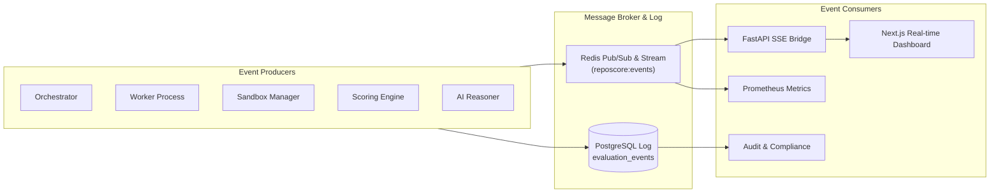

# Internal Event Architecture

> **Document:** `EVENT_ARCHITECTURE.md`  
> **Status:** Active / Architectural Contract  
> **Owner:** Distributed Systems Architecture Team  
> **Referenced ADRs:** ADR-001, ADR-007

---

## 1. Event Bus Purpose & Guarantees

RepoScore uses an **Internal Event Architecture** to decouple pipeline steps, enable real-time UI updates, facilitate structured auditing, and allow evaluation reconstruction:
1. **At-Least-Once Delivery**: Events published to Redis streams and persisted in PostgreSQL guarantee no state change occurs silently.
2. **Deterministic Sequence**: Events carry monotonically increasing timestamps and step sequences.
3. **Audit Immutability**: All events are recorded in `evaluation_events` to provide complete operational auditability.



---

## 2. Standard Event Envelope

Every internal event is wrapped in a standardized envelope:

```json
{
  "event_id": "01925b4a-a000-7000-8000-000000000001",
  "event_type": "evaluation.step.completed",
  "version": "1.0",
  "timestamp": "2026-10-08T22:31:15.420Z",
  "correlation_id": "01925b4a-8d1a-7b3c-9a40-e2b8fa492001",
  "evaluation_id": "01925b4a-8cf2-7612-882f-3d18c9ba1100",
  "producer": "worker.host-node-04",
  "payload": {
    "step_name": "ANALYZING",
    "duration_ms": 4210,
    "findings_count": 18,
    "status": "SUCCESS"
  }
}
```

---

## 3. Canonical Event Catalog

| Event Type | Producer | Emitted When |
|---|---|---|
| `repository.created` | Repository Manager | Target repository registered in system. |
| `repository.ingested` | Repository Manager | Git snapshot cloned, tree hashed, and saved to disk. |
| `evaluation.created` | API Layer | Evaluation task initialized and queued in Redis. |
| `evaluation.started` | Evaluation Worker | Worker claims job and begins execution. |
| `evaluation.step.started` | Evaluation Worker | Pipeline transitions into a new stage (e.g. `BUILDING`). |
| `evaluation.step.completed` | Evaluation Worker | Pipeline stage succeeds with metrics. |
| `evaluation.step.failed` | Evaluation Worker | Stage fails (e.g. compilation error or crash). |
| `sandbox.created` | Sandbox Manager | Ephemeral Docker container instantiated with cgroups. |
| `sandbox.started` | Sandbox Manager | Sandbox container processes initialized. |
| `sandbox.finished` | Sandbox Manager | Container terminated, resources reclaimed. |
| `analysis.completed` | Analyzer Subsystem | All static analyzers and security tools finish scanning. |
| `runtime.test.started` | Runtime Engine | Prober initiates synthetic load or test runner. |
| `runtime.test.completed` | Runtime Engine | Probing finished; latency and error rates gathered. |
| `evidence.created` | Evidence Engine | New finding normalized and written to database. |
| `score.calculated` | Scoring Engine | Deterministic 10-dimension scores and overall score finalized. |
| `ai.analysis.started` | AI Reasoner | Prompt dispatched to local LLM provider. |
| `ai.analysis.completed` | AI Reasoner | Structured JSON summary parsed and persisted. |
| `evaluation.completed` | Orchestrator | Terminal success state reached (`COMPLETED` or `PARTIALLY_COMPLETED`). |
| `evaluation.failed` | Orchestrator | Terminal failure state reached (`FAILED`, `TIMEOUT`, `CANCELLED`). |
