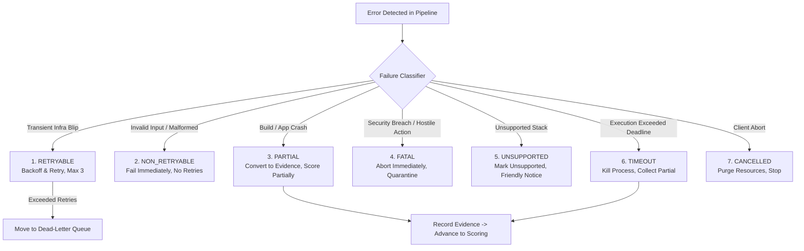

# Failure Model & Recovery Architecture

> **Document:** `FAILURE_MODEL.md`  
> **Status:** Active / Architectural Contract  
> **Owner:** Core Architecture Team  
> **Referenced ADRs:** ADR-001, ADR-007

---

## 1. Failure Taxonomy & Classification

In an autonomous evaluation engine executing untrusted third-party code, failures are not exceptional events—they are expected normal operating conditions. RepoScore categorizes all errors into a strict six-class failure model:

---

## 2. Failure Class Specifications

| Class | Definition | Typical Causes | System Action |
|---|---|---|---|
| **`RETRYABLE`** | Temporary infrastructure glitch expected to resolve shortly. | Redis disconnect, Postgres pool saturation, GitHub API rate limit (429/503). | Exponential backoff with jitter (2s, 4s, 8s). Max 3 attempts before moving to Dead-Letter Queue. |
| **`NON_RETRYABLE`** | Deterministic input error that will never succeed on retry. | Invalid Git URL, repository deleted, repository exceeds 1GB limit, private repository. | Transition immediately to `FAILED` with clear client error message. |
| **`PARTIAL`** | Target repository failed to build, boot, or pass tests. | `npm install` error, syntax error in application, missing DB string, test assertion failures. | **Never abort evaluation!** Record as runtime evidence, assign penalties, transition to `SCORING`, finish as `PARTIALLY_COMPLETED`. |
| **`FATAL`** | System compromise risk or catastrophic internal corruption. | Sandbox breakout attempt, container probe anomaly, disk corruption. | Instantly terminate container, purge mounts, mark evaluation `FAILED`, alert operators. |
| **`UNSUPPORTED`** | Repository contains no recognizable code or supported build system. | Repository contains only images, PDFs, or unmanaged esoteric languages. | Transition to `UNSUPPORTED` status. Explain supported stacks to user. |
| **`TIMEOUT`** | Individual step or overall evaluation exceeded time budget. | Endless loop in application, hanging network call in build step. | Send `SIGKILL` to container, record `TIMEOUT` evidence, proceed to partial scoring. |
| **`CANCELLED`** | Explicit user or administrator termination. | User clicked "Cancel" on dashboard. | Kill running containers, release Redis task lock, mark `CANCELLED`. |

---

## 3. Step & Pipeline Timeout Budgets

To prevent runaway jobs and denial-of-service, strict time budgets are enforced across every phase:

| Phase | Maximum Timeout | Enforcement Mechanism |
|---|---|---|
| **Ingestion (Clone & Snapshot)** | 60 seconds | Git process execution timer (`asyncio.wait_for`) |
| **Static & Security Analysis** | 90 seconds | Analyzer process timer |
| **Sandbox Build (Dependencies)** | 300 seconds (5 min) | Docker container execution timeout watchdog |
| **Application Startup Probe** | 30 seconds | Polling socket timeout |
| **Runtime & Behavioral Probing** | 120 seconds (2 min) | Prober loop timeout |
| **Deterministic Scoring** | 5 seconds | In-memory synchronous calculation budget |
| **AI Narrative Generation** | 60 seconds | HTTP request timeout to LLM provider |
| **Overall Evaluation Ceiling** | 600 seconds (10 min) | Job worker supervisor ceiling |

---

## 4. Recovery & Dead-Letter Handling

1. **Idempotent Step Execution**: All steps can be safely retried without duplicating state. Snapshot generation is content-hashed; evidence ingestion uses unique fingerprint deduplication indexes.
2. **Dead-Letter Queue (DLQ)**: If a `RETRYABLE` task fails 3 consecutive times, it is pushed to the Redis DLQ `reposcore:dlq:evaluations` with full stack traces for engineer inspection.
3. **Container Orphan Recovery**: Worker processes register a periodic background task (every 60s) executing `docker container prune` targeting containers labelled `reposcore.evaluation_id` whose timestamps exceed maximum deadlines.
