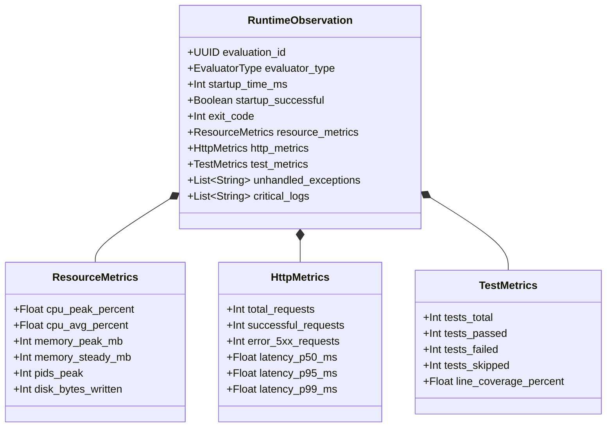

# Runtime & Behavioral Evaluation Architecture

> **Document:** `RUNTIME_ARCHITECTURE.md`  
> **Status:** Active / Architectural Contract  
> **Owner:** Core Architecture Team  
> **Referenced ADRs:** ADR-002, ADR-009

---

## 1. Empirical Runtime Philosophy

RepoScore's core thesis is:
> *"Do not merely analyze what the code looks like. Determine what the software actually does."*

Code that appears pristine in static analysis may fail to compile, crash on startup, leak memory under modest load, or return HTTP 500 errors. The **Runtime Engine** transitions the system from theoretical code inspection to empirical behavioral evaluation.

```mermaid
graph TD
    Entrypoint[Detected Project Type & Entrypoint] --> StrategySelect{Select Runtime Evaluator}

    StrategySelect -->|HTTP / REST API| HttpEval[HTTP API Evaluator]
    StrategySelect -->|CLI Tool| CliEval[CLI Tool Evaluator]
    StrategySelect -->|Library / SDK| LibEval[Library & Test Suite Evaluator]
    StrategySelect -->|Worker / Daemon| WorkerEval[Background Worker Evaluator]
    StrategySelect -->|Unknown / Generic| GenericEval[Generic Build & Run Evaluator]

    subgraph SandboxedExecution ["Ephemeral Sandbox Execution Loop"]
        HttpEval --> SandboxExec[Sandboxed Process Runner]
        CliEval --> SandboxExec
        LibEval --> SandboxExec
        WorkerEval --> SandboxExec
        GenericEval --> SandboxExec

        SandboxExec --> Watchdog[Resource Telemetry Poller (CPU / RAM / IO)]
        SandboxExec --> LogCapture[Multiplexed Stdout / Stderr Streamer]
        SandboxExec --> Prober[Synthetic Health & Traffic Prober]
    end

    Watchdog --> ObservationAggregator[Runtime Observation Aggregator]
    LogCapture --> ObservationAggregator
    Prober --> ObservationAggregator

    ObservationAggregator --> EvidenceEngine[Evidence Engine]
```

---

## 2. Pluggable Evaluator Types

### 2.1 HTTP & REST API Evaluator (`HttpApiEvaluator`)
For web frameworks (FastAPI, Flask, Express, NestJS, Next.js, Actix, Gin, Spring Boot):
1. **Bootstrapping**: Launches server in the sandbox using detected startup command (e.g. `uvicorn main:app --port 8000`).
2. **Readiness Probing**: Polls loopback socket `127.0.0.1:PORT` every 200ms up to a configurable startup timeout (default: 30s).
3. **Health & Endpoint Discovery**:
   - Probes canonical health endpoints: `/health`, `/healthz`, `/ready`, `/status`, `/api/health`, `/`.
   - Checks OpenAPI / Swagger docs: `/docs`, `/openapi.json`, `/swagger.json`.
4. **Synthetic Load & Stress Probing**:
   - Executes 50 synthetic HTTP requests across 10 concurrent connections.
   - Measures latency percentiles: $p50$, $p95$, $p99$.
   - Calculates error rate (HTTP 5xx responses).
5. **Termination Verification**:
   - Emits `SIGTERM` and measures graceful shutdown time (must exit within 5s without zombie sockets).

---

### 2.2 CLI Application Evaluator (`CliEvaluator`)
For command-line utilities and tools:
1. **Help & Version Invocations**:
   - Executes `--help` and `-h`. Verifies exit code `0` and parses help text completeness.
   - Executes `--version` and verifies semantic version string output.
2. **Invalid Parameter Resilience**:
   - Invocations with invalid options (e.g., `--invalid-flag-xyz`) to verify that the application returns a non-zero exit code and clean error messages rather than unhandled tracebacks.
3. **Output Format Adherence**:
   - Tests optional `--json` or `--quiet` flags if indicated in documentation.

---

### 2.3 Library & SDK Evaluator (`LibraryEvaluator`)
For reusable libraries and packages that do not run as standalone servers:
1. **Test Runner Invocation**:
   - Detects and triggers native test frameworks: `pytest`, `npm test`, `cargo test`, `go test`, `mvn test`.
2. **Test Metric Extraction**:
   - Parses structured test reports (JUnit XML, TAP, JSON).
   - Records total tests, tests passed, tests failed, skipped tests, execution duration.
3. **Code Coverage Inspection**:
   - Inspects coverage reports (`.coverage`, `coverage.lcov`, `jacoco.xml`).
   - Computes line coverage and branch coverage percentages.

---

### 2.4 Worker & Background Service Evaluator (`WorkerEvaluator`)
For queue consumers, background schedulers, and stream processors:
1. **Startup & Signal Verification**:
   - Launches worker and monitors standard output for readiness logs.
   - Verifies process stability over a 15-second observation window.
2. **Graceful Shutdown**:
   - Sends `SIGTERM` and verifies that the process flushes buffers and terminates cleanly.

---

## 3. Runtime Telemetry & Resource Observation

While the application runs inside the sandbox, a host-side **Telemetry Poller** samples the container cgroups stats every 500ms:



---

## 4. Runtime Failure Classification

When runtime execution does not complete successfully, the engine classifies the incident into structured failure categories:

| Failure Code | Root Cause | Handling & Score Impact |
|---|---|---|
| `BUILD_FAILURE` | Missing dependencies, syntax error during compilation, broken build script. | High penalty on Correctness/Reliability; static score preserved; partial completion. |
| `STARTUP_TIMEOUT` | App hung, waited indefinitely for database or external service without timeout. | Reliability penalty; flagged as architectural issue (lack of standalone dev mode). |
| `CRASH_ON_BOOT` | Immediate unhandled exception, missing required environment variable with no default. | Correctness penalty; stack trace captured as critical evidence. |
| `OOM_KILLED` | Exceeded 2048MB memory limit during build or launch. | Memory leak/bloat evidence; performance penalty. |
| `HIGH_ERROR_RATE` | More than 10% of synthetic HTTP requests returned status 5xx. | Reliability & Correctness penalties. |
| `ZOMBIE_ON_SHUTDOWN` | Failed to cleanly terminate on SIGTERM within 5 seconds. | Maintainability / Reliability penalty. |
