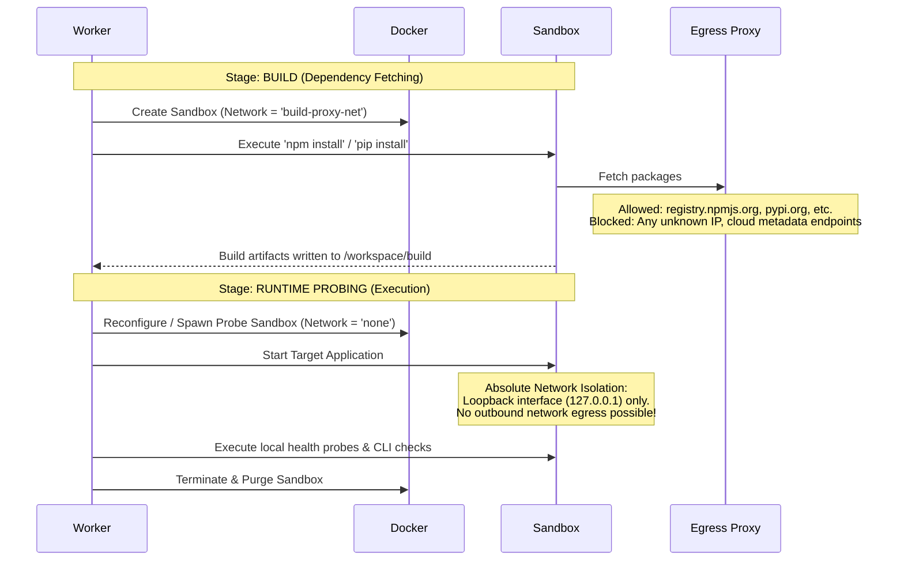

# Sandbox Architecture & Isolation Model

> **Document:** `SANDBOX_ARCHITECTURE.md`  
> **Status:** Active / Architectural Contract  
> **Owner:** Security & Systems Architecture Team  
> **Referenced ADRs:** ADR-002, ADR-009

---

## 1. Security Philosophy & Threat Model

RepoScore executes arbitrary code submitted from external repositories. By definition:
1. **Source code is untrusted and hostile**: Source files may contain exploit payloads, obfuscated backdoors, cryptominers, fork bombs, network scanners, or container breakout attempts.
2. **Build and dependency scripts are hostile**: Package manager hooks (such as `npm postinstall`, `setup.py`, `Cargo build.rs`, or `Makefile`) execute arbitrary code during installation and build stages.
3. **Container isolation is necessary but requires defense-in-depth**: Standard Docker containerization without hardened constraints does not constitute an impenetrable security boundary. We enforce layered defense: user namespaces, strict cgroups, capability stripping, seccomp filters, ephemeral filesystems, and network firewalls.

---

## 2. Sandbox Container Architecture

```mermaid
graph TB
    subgraph HostOS ["Host Operating System (Linux / Kernel 6.x)"]
        DockerDaemon["Docker Daemon (dockerd)"]
        WorkerProcess["Worker Orchestrator Process"]
        AppArmor["AppArmor / Seccomp Enforcer"]

        subgraph CgroupsLayer ["cgroups v2 Enforcement"]
            MemLimit["Memory: Hard Max 2048MB"]
            CPULimit["CPU: Max 2.0 Cores (Quota)"]
            PIDLimit["PIDs: Max 256 Processes"]
        end
    end

    subgraph ContainerSandbox ["Ephemeral Container Sandbox"]
        UserNS["Non-Root User: UID 10001 / GID 10001"]
        CapDrop["Capabilities: ALL DROPPED (--cap-drop=ALL)"]
        NoPriv["no-new-privileges: true"]

        subgraph Mounts ["Filesystem Mount Isolation"]
            RootFS["Root Filesystem (Read-Only :ro)"]
            SrcMount["Repository Snapshot (/workspace/src :ro)"]
            TmpFS["Ephemeral Scratchpad (/workspace/build :tmpfs 1GB)"]
        end

        subgraph ExecutionPayload ["Untrusted Process Execution"]
            BuildProc["Build Step (e.g. npm run build)"]
            RunProc["Target Application (e.g. uvicorn main:app)"]
        end
    end

    subgraph NetworkPolicy ["Dynamic Network Policy Engine"]
        BuildNet["Build Phase: Restricted Egress Proxy (Whitelisted Registries)"]
        RunNet["Runtime Phase: STRICT ISOLATION (--network none)"]
    end

    WorkerProcess -->|Docker API (Unix Socket)| DockerDaemon
    DockerDaemon --> ContainerSandbox
    CgroupsLayer -.-> ContainerSandbox
    AppArmor -.-> ContainerSandbox
    NetworkPolicy -.-> ContainerSandbox
```

---

## 3. Containment & Hardening Specifications

### 3.1 Kernel Isolation & User Namespaces
- **Non-Root Execution**: Containers run under unprivileged user `sandbox` (`uid: 10001`, `gid: 10001`). No sudo or setuid binaries exist in the container image.
- **Drop Capabilities**: All 38 standard Linux kernel capabilities are stripped via `--cap-drop=ALL`. No network raw socket creation (`CAP_NET_RAW`), no device mounting (`CAP_SYS_ADMIN`), and no ownership changes (`CAP_CHOWN`).
- **No New Privileges**: Configured with `--security-opt=no-new-privileges:true` to ensure processes cannot escalate privileges via suid/sgid binaries.
- **Seccomp Profile**: Applied strict custom seccomp profile denying dangerous syscalls (e.g., `ptrace`, `sys_chroot`, `keyctl`, `bpf`, `mount`).

### 3.2 Resource Constraints (cgroups v2)
Every sandbox container is strictly throttled to prevent resource exhaustion and denial-of-service:
- **Memory Ceiling**:
  - `memory = 2048m` (Hard limit)
  - `memory-swap = 2048m` (Swap disabled to prevent disk thrashing)
  - `oom-kill-disable = false` (Kernel OOM killer immediately terminates runaway processes)
- **CPU Quota**:
  - `cpus = 2.0`
  - `cpu-shares = 1024`
  - `cpu-quota = 200000` with `cpu-period = 100000`
- **PID Quota (Anti-Fork Bomb)**:
  - `pids-limit = 256` (Limits process tree depth, preventing fork bomb degradation of the host)
- **Disk Write Ceiling**:
  - Root filesystem is mounted strictly read-only (`--read-only`).
  - Writable work directories use memory-backed `tmpfs`:
    `--tmpfs /workspace/build:rw,noexec,nosuid,size=1024m`
    `--tmpfs /tmp:rw,noexec,nosuid,size=256m`

---

## 4. Network Isolation Policies

The network lifecycle of the sandbox is phased based on the evaluation stage:



### Egress Whitelist Rules (Build Phase)
- Permitted domains strictly limited to official package registries:
  - Python: `pypi.org`, `files.pythonhosted.org`
  - Node: `registry.npmjs.org`
  - Rust: `crates.io`, `static.crates.io`
  - Go: `proxy.golang.org`
- Explicitly blocked:
  - Cloud metadata APIs (`169.254.169.254`)
  - Host localhost addresses (`127.0.0.1`, `host.docker.internal`)
  - All internal corporate or private subnets (`10.0.0.0/8`, `172.16.0.0/12`, `192.168.0.0/16`)

---

## 5. Sandbox Lifecycle & Teardown

```python
# Conceptual Sandbox Context Manager Interface
class EphemeralSandbox:
    async def __aenter__(self):
        self.container = await docker_client.containers.create(
            image=self.base_image,
            user="10001:10001",
            cap_drop=["ALL"],
            security_opt=["no-new-privileges:true"],
            mem_limit="2048m",
            pids_limit=256,
            network_mode=self.network_policy,
            volumes={
                self.snapshot_dir: {"bind": "/workspace/src", "mode": "ro"},
            },
            tmpfs={
                "/workspace/build": "rw,size=1024m",
                "/tmp": "rw,size=256m",
            },
            read_only=True,
        )
        await self.container.start()
        return self

    async def __aexit__(self, exc_type, exc_val, exc_tb):
        try:
            # Enforce hard kill and complete resource purging
            await self.container.kill()
        except DockerException:
            pass
        finally:
            await self.container.remove(v=True, force=True)
```

### Teardown Invariants:
1. Every container is tagged with an evaluation metadata label: `reposcore.evaluation_id = {uuid}`.
2. An asynchronous orphan cleaner executes periodically on each worker host to force-kill any container running longer than the maximum evaluation timeout ($T_{\text{max}} = 10\text{ min}$).
3. Host filesystem mounts are exclusively read-only (`:ro`). Writable data resides in `tmpfs`, automatically reclaimed upon container termination.

---

## 6. Future Isolation Enhancements

While Docker with user namespaces and capability stripping provides substantial security, future iterations will support:
- **gVisor (`runsc`)**: User-space kernel interception providing a virtualization boundary for hyper-paranoid untrusted execution without the overhead of full VMs.
- **Firecracker MicroVMs**: Ephemeral KVM-based microVMs booting in under 100ms for total hardware virtualization isolation.
The `ISandboxManager` abstraction completely isolates these backends behind a unified execution interface.
