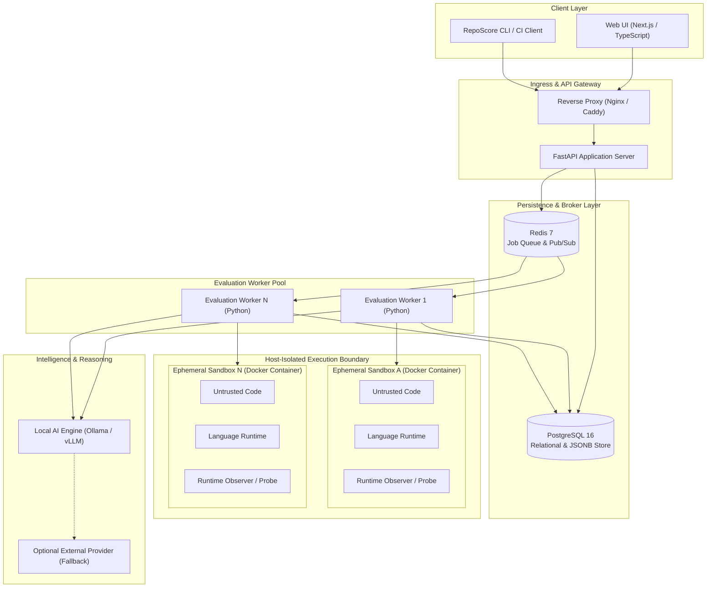
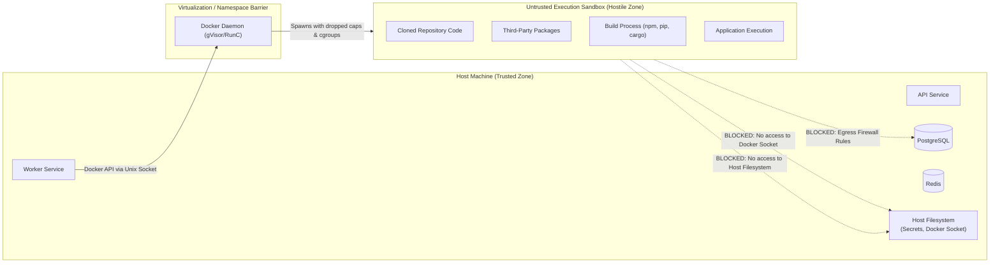

# System Architecture

> **Document:** `SYSTEM_ARCHITECTURE.md`  
> **Status:** Active / Architectural Contract  
> **Owner:** Core Architecture Team  
> **Referenced ADRs:** ADR-001, ADR-002, ADR-006, ADR-007

---

## 1. System Overview

**RepoScore** is an autonomous repository intelligence and software evaluation engine designed to empirically analyze, build, execute, observe, and score open-source and proprietary software repositories without human intervention.

Unlike conventional static code scanners that merely analyze text syntax, RepoScore is built around an **empirical runtime philosophy**:
> *"Do not merely analyze what the code looks like. Determine what the software actually does."*

RepoScore verifies whether a repository compiles, passes automated tests, launches, services requests or executes CLI commands, behaves deterministically under load, complies with security policies, and follows sustainable engineering practices.

---

## 2. High-Level System Architecture

RepoScore is architected as a **modular monolith backend** with **asynchronous worker execution**, backed by **PostgreSQL** for relational persistence, **Redis** for distributed task orchestration and pub/sub events, an isolated **Docker Sandbox runtime**, and a **Next.js** presentation layer.

---

## 3. Subsystem Decomposition

The system is decomposed into distinct logical domains:

1. **API Layer (`backend/api`)**:
   - HTTP REST interfaces, request validation, authentication, rate limiting, and evaluation triggering.
   - Publishes WebSocket or SSE streams for live evaluation status tracking.

2. **Repository Manager (`backend/repository`)**:
   - Ingestion, validation, git cloning, commit verification, shallow cloning, branch detection, and construction of immutable repository snapshots on disk.

3. **Evaluation Orchestrator & Workers (`backend/orchestration`, `backend/workers`)**:
   - Manages the discrete multi-stage evaluation state machine (`QUEUED` $\to$ `COMPLETED`).
   - Receives jobs via Redis task queue, executes evaluation plans, collects intermediate state, and handles retries or timeouts.

4. **Sandbox Manager (`backend/sandbox`)**:
   - Programmatically orchestrates ephemeral Docker containers.
   - Enforces strict execution boundaries: non-root execution, cgroups limits (CPU, memory, PIDs), read-only base mounts, and network isolation policies.

5. **Static & Security Analyzers (`backend/analyzers`, `backend/security`)**:
   - Pluggable adapter architecture running Tree-sitter, Semgrep, Ruff, Bandit, OSV, and language tooling.
   - Translates findings into normalized structured evidence.

6. **Runtime & Behavioral Engine (`backend/runtime`)**:
   - Detects entry points, framework configurations, and targets (CLI, REST API, Library, Worker).
   - Coordinates build steps, container execution, process monitoring, HTTP/CLI probing, synthetic test dispatch, and resource telemetry capture.

7. **Evidence Engine (`backend/evidence`)**:
   - Ingestion, validation, deduplication, categorization, and persistence of all findings and telemetry.
   - Serves as the single source of truth for downstream scoring and reasoning.

8. **Deterministic Scoring Engine (`backend/scoring`)**:
   - Calculates 10-dimensional evaluation scores based exclusively on structured evidence.
   - Applies mathematical formulas and transparent weight trees. Strictly non-AI, 100% reproducible.

9. **AI Reasoning Engine (`backend/ai`)**:
   - Local-first LLM integration (Ollama / quantized models) to generate architectural summaries, explain failure traces, and highlight code hygiene risks.
   - Strictly isolated from numerical score calculation.

10. **Observability Subsystem (`backend/observability`)**:
    - Centralized OpenTelemetry instrumentation, structured JSON logging, correlation IDs across all jobs, and Prometheus-compatible metrics export.

---

## 4. Security Boundaries

RepoScore evaluates arbitrary third-party code from public repositories, which must be treated as **actively malicious**. The architectural security boundaries are illustrated below:

### Security Boundary Rules:
- **No Direct Host Execution:** Untrusted repository code, build scripts (`npm install`, `setup.py`, `Makefile`), or binaries are **NEVER** executed on the host OS.
- **Docker Socket Containment:** The host Docker socket (`/var/run/docker.sock`) is accessible ONLY to the trusted worker orchestration process and is NEVER mounted inside sandbox containers.
- **Egress Filtering:** Sandboxes operate under strict egress policies. During build stages, network access is restricted to official package registries (PyPI, npm, crates.io). During runtime evaluation stages, external network egress is completely disabled (`--network none`) or strictly routed through a monitoring proxy.
- **Rootless / Capability Drop:** Sandboxes execute under a dedicated unprivileged user (`uid 10001`), dropping all Linux capabilities (`--cap-drop=ALL`) with `no-new-privileges:true`.

---

## 5. Deployment Topology

The system supports two deployment profiles:

### 5.1 Local / Developer Profile (Docker Compose)
A completely free, self-contained, single-host configuration for local evaluation:
- 1x Next.js Frontend container
- 1x FastAPI Backend container
- 1x Redis container
- 1x PostgreSQL container
- 1x Ollama AI service (local CPU/GPU)
- 1x Local Docker host socket for worker container instantiation

### 5.2 Production / Clustered Profile
A horizontally scalable deployment:
- Stateless Next.js instances behind CDN / Load Balancer
- Stateless FastAPI API nodes
- Managed PostgreSQL with read replicas
- Managed Redis Cluster
- Horizontally autoscaling Worker nodes running on dedicated container host instances equipped with rootless container runtimes or gVisor (`runsc`).

---

## 6. Architecture Evolution & Extensibility

- **Worker Decoupling:** The worker communicates with the core system solely via Redis queues and Postgres database entities, allowing workers to run across heterogeneous server pools.
- **Analyzer Pluggability:** Adding a new static analyzer requires implementing a standard Python abstract base class without modifying the evaluation pipeline.
- **Runtime Pluggability:** New language and application runtimes (e.g., Rust, Go, Java, Elixir) plug in via declarative runtime descriptor templates.
