# Entity-Relationship Model & Data Lineage Specification

> **Document:** `ENTITY_RELATIONSHIP_MODEL.md`  
> **System:** RepoScore — Autonomous Repository Intelligence & Software Evaluation Engine  
> **Status:** Active / Persistence Baseline  
> **Authority:** [`docs/architecture/SYSTEM_ARCHITECTURE.md`](file:///c:/Partition/SERIOUS%20PROJECTS/REPO-Score/docs/architecture/SYSTEM_ARCHITECTURE.md), [`AGENTS.md`](file:///c:/Partition/SERIOUS%20PROJECTS/REPO-Score/AGENTS.md)

---

## 1. Persistence Overview & Core Principles

RepoScore relies on **PostgreSQL 16+** as its authoritative, unified relational and document datastore:
1. **Evidence-First Lineage:** Every score deduction and credit references a specific `Evidence` record. Every piece of `Evidence` references an `Evaluation` and an immutable `RepositorySnapshot`.
2. **Snapshot Immutability:** A repository snapshot is frozen at an exact Git commit SHA. Once ingested and hashed, a snapshot can never be modified.
3. **Sealed Terminal State Immutability:** Once an evaluation reaches a terminal state (`COMPLETED`, `PARTIALLY_COMPLETED`, `FAILED`, `CANCELLED`, `UNSUPPORTED`), its scores, dimensions, evidence, findings, and telemetry become strictly append-only and immutable.
4. **Hybrid Relational + JSONB Modeling:** Core domain boundaries, ownership, and references enforce strict foreign keys and relational integrity; tool outputs, AST metrics, itemized receipts, and structured payloads leverage indexed `JSONB`.

---

## 2. Master Entity-Relationship Diagram (ERD)

```mermaid
erDiagram
    Repository ||--o{ RepositorySnapshot : "has_snapshots"
    Repository ||--o{ Evaluation : "evaluated_in"
    RepositorySnapshot ||--o{ Evaluation : "evaluated_against"
    
    Evaluation ||--o{ EvaluationStep : "progresses_through"
    Evaluation ||--o{ ExecutionEnvironment : "executed_in"
    Evaluation ||--o{ TestScenario : "executes"
    Evaluation ||--o{ RuntimeObservation : "records"
    Evaluation ||--o{ StaticFinding : "detects"
    Evaluation ||--o{ SecurityFinding : "identifies"
    Evaluation ||--o{ Evidence : "produces"
    Evaluation ||--o{ EvaluationEvent : "emits"
    
    Evaluation ||--|| Score : "receives"
    Score ||--|{ ScoreDimension : "composed_of"
    
    Evaluation ||--o{ AIAnalysis : "interpreted_by"
    AIAnalysis ||--o{ Recommendation : "generates"
    
    Evidence ||--o{ StaticFinding : "links_to"
    Evidence ||--o{ SecurityFinding : "links_to"
    Evidence ||--o{ RuntimeObservation : "links_to"
```



---

## 3. The 15 Core Conceptual Entities

### 3.1 `Repository`
- **Purpose:** Represents the external software repository identity, remote origin, and high-level tracking metadata.
- **Cardinality:** `1:N` with `RepositorySnapshot`, `1:N` with `Evaluation`.
- **Primary Key:** `UUIDv7`
- **Key Attributes:** `url` (unique), `provider` (`github`), `owner`, `name`, `default_branch`, `is_private`, `stars_count`, `forks_count`, `license_spdx`, `created_at`, `updated_at`.
- **Mutability:** Mutable metadata (stars, forks, updated timestamps updated on ingestion).

### 3.2 `RepositorySnapshot`
- **Purpose:** An immutable, tamper-proof point-in-time extraction of the repository files pinned to an exact 40-character Git commit SHA.
- **Cardinality:** Child of `Repository`, `1:N` with `Evaluation`.
- **Primary Key:** `UUIDv7`
- **Key Attributes:** `repository_id` (FK), `commit_sha` (CHAR 40), `tree_hash` (CHAR 64 SHA-256), `branch_or_tag`, `storage_path`, `size_bytes`, `file_count`, `detected_languages` (JSONB), `detected_frameworks` (JSONB), `detected_entrypoints` (JSONB), `created_at`.
- **Immutability:** Strictly immutable. Unique constraint on `(repository_id, commit_sha)`.

### 3.3 `Evaluation`
- **Purpose:** The master orchestration entity tracking an end-to-end evaluation run against a specific repository snapshot.
- **Cardinality:** Child of `Repository` and `RepositorySnapshot`, parent to all lifecycle, evidence, and result entities.
- **Primary Key:** `UUIDv7`
- **Key Attributes:** `repository_id` (FK), `snapshot_id` (FK), `status` (17-state FSM enum), `correlation_id` (UUIDv7), `trigger_source` (`MANUAL`, `API`, `WEBHOOK`), `worker_id`, `started_at`, `completed_at`, `duration_ms`, `error_summary`, `created_at`.
- **Lifecycle:** Transitions through active FSM states until reaching terminal state, after which it is sealed.

### 3.4 `EvaluationStep`
- **Purpose:** Granular, audit-logged progress records for every discrete phase in the evaluation lifecycle.
- **Cardinality:** Child of `Evaluation` (`1:N`).
- **Primary Key:** `UUIDv7`
- **Key Attributes:** `evaluation_id` (FK), `step_name` (`INGESTING`, `ANALYZING`, `BUILDING`, `STARTING`, `TESTING`, `OBSERVING`, `SCORING`, `AI_INTERPRETATION`), `status` (`SUCCESS`, `FAILURE`, `SKIPPED`, `CANCELLED`), `started_at`, `completed_at`, `duration_ms`, `exit_code`, `error_message`, `step_metadata` (JSONB).
- **Immutability:** Append-only step log.

### 3.5 `ExecutionEnvironment`
- **Purpose:** Detailed metadata recording the quarantined sandbox container environment configuration used for build and runtime evaluation.
- **Cardinality:** Child of `Evaluation` (`1:N` or `1:1`).
- **Primary Key:** `UUIDv7`
- **Key Attributes:** `evaluation_id` (FK), `container_id`, `base_image`, `runtime_type` (`DOCKER_RUNC`, `GVISOR`, `FIRECRACKER`), `cpu_quota`, `memory_limit_bytes`, `pids_limit`, `network_policy` (`PROXY_BUILD`, `NONE`), `capabilities_dropped` (TEXT[]), `uid_enforced`, `gid_enforced`, `seccomp_profile_digest`, `created_at`.
- **Immutability:** Immutable execution provenance record.

### 3.6 `TestScenario`
- **Purpose:** Specifications and execution records for individual test suites and probes run against the repository code.
- **Cardinality:** Child of `Evaluation` (`1:N`).
- **Primary Key:** `UUIDv7`
- **Key Attributes:** `evaluation_id` (FK), `name`, `scenario_type` (`REPOSITORY_PROVIDED`, `PLATFORM_DETERMINISTIC`, `AI_GENERATED`, `RUNTIME_SCENARIO`, `SECURITY`), `command_executed`, `exit_code`, `passed`, `duration_ms`, `test_count`, `pass_count`, `fail_count`, `stdout_excerpt`, `stderr_excerpt`, `created_at`.
- **Immutability:** Immutable execution record.

### 3.7 `RuntimeObservation`
- **Purpose:** Time-series telemetry and runtime metrics sampled during application startup, probing, and execution.
- **Cardinality:** Child of `Evaluation` (`1:N`).
- **Primary Key:** `UUIDv7`
- **Key Attributes:** `evaluation_id` (FK), `observation_type` (`STARTUP_LATENCY`, `HTTP_PROBE`, `CPU_USAGE`, `MEMORY_RSS`, `EXIT_STATUS`, `CRASH_SIGNAL`), `sampled_at`, `metric_value_numeric`, `metric_value_string`, `metadata` (JSONB).
- **Immutability:** Append-only telemetry log.

### 3.8 `StaticFinding`
- **Purpose:** Direct outputs from static analyzers (Tree-sitter, Semgrep, Ruff, Bandit, ESLint) prior to evidence normalization.
- **Cardinality:** Child of `Evaluation` (`1:N`).
- **Primary Key:** `UUIDv7`
- **Key Attributes:** `evaluation_id` (FK), `tool_name`, `tool_version`, `rule_id`, `file_path`, `start_line`, `end_line`, `start_col`, `end_col`, `raw_severity`, `message`, `snippet`, `created_at`.
- **Immutability:** Append-only analyzer findings.

### 3.9 `SecurityFinding`
- **Purpose:** Security-specific findings: CVE vulnerabilities from OSV/Trivy, hardcoded secret discoveries, and OWASP rule violations.
- **Cardinality:** Child of `Evaluation` (`1:N`).
- **Primary Key:** `UUIDv7`
- **Key Attributes:** `evaluation_id` (FK), `vulnerability_id` (e.g., `CVE-2023-32681` or `GHSA-xxx`), `package_name`, `installed_version`, `fixed_version`, `cvss_score`, `severity` (`CRITICAL`, `HIGH`, `MEDIUM`, `LOW`), `cwe_ids` (TEXT[]), `description`, `created_at`.
- **Immutability:** Append-only vulnerability records.

### 3.10 `Evidence`
- **Purpose:** The canonical, unified, normalized evidence record consumed directly by the deterministic scoring engine.
- **Cardinality:** Child of `Evaluation` (`1:N`). Linked to primary findings.
- **Primary Key:** `UUIDv7`
- **Key Attributes:** `evaluation_id` (FK), `source`, `category` (`CORRECTNESS`, `SECURITY`, `RELIABILITY`, `TESTING`, `MAINTAINABILITY`, `ARCHITECTURE`, `PERFORMANCE`, `DEPENDENCY_HEALTH`, `DOCUMENTATION`, `ENGINEERING_MATURITY`), `severity` (`CRITICAL`, `HIGH`, `MEDIUM`, `LOW`, `INFO`), `confidence` (FLOAT $0.0-1.0$), `fingerprint` (CHAR 64 SHA-256 for deduplication), `title`, `description`, `location` (JSONB), `raw_payload` (JSONB), `normalized_attributes` (JSONB), `related_evidence_ids` (UUID[]), `created_at`.
- **Immutability:** Strictly immutable. Unique constraint on `(evaluation_id, fingerprint)`.

### 3.11 `Score`
- **Purpose:** Master deterministic scorecard record holding the composite numerical score, letter grade, and ruleset version.
- **Cardinality:** Child of `Evaluation` (`1:1`). Parent of `ScoreDimension`.
- **Primary Key:** `UUIDv7`
- **Key Attributes:** `evaluation_id` (FK, UNIQUE), `scoring_version` (`1.0.0`), `overall_score` (NUMERIC 5,2 clamped $0.0-100.0$), `grade` (`A+`, `A`, `B`, `C`, `D`, `F`), `total_deductions`, `total_credits`, `created_at`.
- **Immutability:** 100% immutable once calculated.

### 3.12 `ScoreDimension`
- **Purpose:** Itemized score breakdown for each of the 10 engineering dimensions.
- **Cardinality:** Child of `Score` (`10:1`), exactly 10 rows per Score.
- **Primary Key:** `UUIDv7`
- **Key Attributes:** `score_id` (FK), `dimension_name` (`Correctness`, `Security`, etc.), `score` (NUMERIC 5,2 clamped $0.0-100.0$), `weight` (NUMERIC 4,3), `base_score` (100.0), `itemized_receipt` (JSONB array of deductions/credits referencing `evidence_id`), `created_at`.
- **Immutability:** Strictly immutable. Unique on `(score_id, dimension_name)`.

### 3.13 `AIAnalysis`
- **Purpose:** Qualitative synthesis, executive narrative, architectural explanation, and failure root-cause analysis generated by the auxiliary LLM.
- **Cardinality:** Child of `Evaluation` (`1:1` or `1:N` versioned).
- **Primary Key:** `UUIDv7`
- **Key Attributes:** `evaluation_id` (FK, UNIQUE), `provider` (`ollama`), `model_name` (`llama3.2:3b`), `prompt_version`, `executive_summary` (TEXT), `architectural_assessment` (TEXT), `runtime_failure_root_cause` (TEXT), `security_risk_narrative` (TEXT), `tokens_consumed`, `duration_ms`, `created_at`.
- **Immutability:** Immutable qualitative record.

### 3.14 `Recommendation`
- **Purpose:** Prioritized, actionable remediation recommendations generated from AI synthesis and linked to empirical evidence.
- **Cardinality:** Child of `AIAnalysis` (`1:N`).
- **Primary Key:** `UUIDv7`
- **Key Attributes:** `ai_analysis_id` (FK), `title`, `category`, `priority` (`HIGH`, `MEDIUM`, `LOW`), `explanation` (TEXT), `actionable_steps` (JSONB), `related_evidence_ids` (UUID[]), `created_at`.
- **Immutability:** Append-only recommendations.

### 3.15 `EvaluationEvent`
- **Purpose:** Real-time lifecycle event log emitted to Redis Pub/Sub and mirrored to PostgreSQL for historical SSE playback and debugging.
- **Cardinality:** Child of `Evaluation` (`1:N`).
- **Primary Key:** `UUIDv7`
- **Key Attributes:** `evaluation_id` (FK), `event_type` (`evaluation.started`, `evaluation.step.completed`, `evidence.created`, etc.), `payload` (JSONB), `emitted_at`.
- **Immutability:** Append-only event stream.

---

## 4. Data Lineage & Traceability Pipeline

The diagram below illustrates the strict data lineage from an external commit to the final scorecard receipt:

```text
GitHub Commit SHA (External Origin)
  │
  ▼
[RepositorySnapshot] (Immutable tree hash & file manifest)
  │
  ├──► [StaticFinding] (Semgrep / Tree-sitter / Ruff output)
  ├──► [SecurityFinding] (OSV CVE advisory output)
  └──► [ExecutionEnvironment] ──► [TestScenario] ──► [RuntimeObservation] (Telemetry)
         │
         ▼
[Evidence] (Canonical, fingerprinted, categorized, normalized)
  │
  ├──────────────────────────────────┐
  ▼                                  ▼
[Scoring Engine]               [AI Subsystem]
  │ (Pure Math)                  │ (Advisory Only)
  ▼                              ▼
[Score] + [ScoreDimension]     [AIAnalysis] + [Recommendation]
  │ (Itemized Receipts)
  ▼
Client Scorecard & Traceable Report
```

1. **Commit Lineage:** Every single evaluation binds immutably to a `snapshot_id` and a 40-character `commit_sha`.
2. **Finding Attribution:** Every `Evidence` item is fingerprinted with SHA-256 over its location and normalized content, preventing duplicates and establishing source attribution.
3. **Scoring Receipts:** Every deduction and credit in `score_dimensions.itemized_receipt` carries an explicit `evidence_id`, making unbacked point penalties mathematically impossible.
4. **AI Independence:** `Score` has zero dependencies on `AIAnalysis`. If the AI subsystem fails or is disabled, the scoring data lineage remains completely intact.
