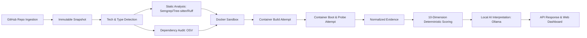

# Minimum Viable Product (MVP) Scope Specification

> **Document:** `MVP_SCOPE.md`  
> **System:** RepoScore — Autonomous Repository Intelligence & Software Evaluation Engine  
> **Status:** Active / Requirements Baseline  
> **Authority:** [`docs/architecture/SYSTEM_ARCHITECTURE.md`](file:///c:/Partition/SERIOUS%20PROJECTS/REPO-Score/docs/architecture/SYSTEM_ARCHITECTURE.md), [`AGENTS.md`](file:///c:/Partition/SERIOUS%20PROJECTS/REPO-Score/AGENTS.md)

---

## 1. MVP Purpose & Core Thesis

The primary objective of the RepoScore MVP is to prove the core product thesis:
> **Core Thesis:** Software repositories must be evaluated using empirical, observable runtime evidence and deterministic analysis rather than superficial static appearance or fabricated metrics alone.

The MVP establishes the complete end-to-end vertical slice, connecting repository ingestion through isolated container execution to deterministic scoring and AI explanation.

---

## 2. Supported Technology Profiles in MVP

To guarantee high depth, reliability, and security, the MVP deliberately scopes runtime execution to two mainstream ecosystems:

### 2.1 Python Profile (Tier 1 Support)
- **Supported Application Types:**
  - `WEB_API`: FastAPI, Flask (HTTP listening applications)
  - `CLI_TOOL`: Click, Argparse, Typer command-line tools
- **Dependency & Build Managers:**
  - `pip` (`requirements.txt`)
  - `poetry` (`pyproject.toml`, `poetry.lock`)
- **Static Analyzers:**
  - Tree-sitter (Python grammar AST parsing, cognitive/cyclomatic complexity)
  - Semgrep (Python security rules, OWASP Top 10)
  - Ruff (Fast linter for style, unused imports, anti-patterns)
  - Bandit (Security patterns)
- **Dependency Vulnerability Scanning:**
  - OSV (Open Source Vulnerabilities querying against PyPI package versions)
- **Runtime Execution:**
  - `reposcore/sandbox-python:3.11-slim` base image
  - Synthetic HTTP probing (`GET /`, `/docs`, `/health`)
  - Resource usage telemetry (CPU, RAM, exit codes)

### 2.2 Node.js / TypeScript Profile (Tier 1 Support)
- **Supported Application Types:**
  - `WEB_API`: Express, NestJS (HTTP REST servers)
  - `CLI_TOOL`: Node CLI utilities
- **Dependency & Build Managers:**
  - `npm` (`package.json`, `package-lock.json`)
- **Static Analyzers:**
  - Tree-sitter (JavaScript / TypeScript grammar)
  - Semgrep (JavaScript security rules)
  - ESLint (Rule audit where configuration exists)
- **Dependency Vulnerability Scanning:**
  - OSV (npm ecosystem advisories)
- **Runtime Execution:**
  - `reposcore/sandbox-node:20-slim` base image
  - Synthetic HTTP probing
  - Resource usage telemetry

---

## 3. In-Scope vs. Post-MVP Feature Matrix

| Feature Area | In-Scope for MVP (Phase 02 – Phase 13) | Post-MVP / Future (Phase 14+) |
|---|---|---|
| **Repository Ingestion** | Public GitHub repositories, Git shallow clone, commit pinning, immutable disk snapshots. | Private GitHub repos via OAuth/App, GitLab, Bitbucket, self-hosted Git servers. |
| **Technology Support** | Python (3.11), Node.js (v20), TypeScript. | Java/Maven, Go, Rust, Ruby, C/C++, PHP, multi-service monorepos. |
| **Static Analyzers** | Tree-sitter, Semgrep, Ruff, Bandit, OSV advisory scanner. | SonarQube integration, CodeQL, commercial SAST tooling. |
| **Sandbox Isolation** | Ephemeral Docker container, `--cap-drop=ALL`, UID 10001, `--read-only`, cgroups v2 quotas. | MicroVM isolation (gVisor `runsc`, Firecracker microVMs), eBPF syscall auditing. |
| **Network Egress** | Internal package proxy during build; `--network none` during test/runtime probing. | Fine-grained per-host eBPF DNS egress firewall. |
| **Runtime Evaluation** | Synthetic HTTP GET/POST probing, entrypoint execution, container stdout/stderr capture. | Full autonomous multi-step API workflow execution, WebSocket testing, mock database injection. |
| **Deterministic Scoring** | 10 dimensions, mathematical formulas, severity multipliers, itemized deduction receipts, semver versioning. | Custom user-defined scoring profiles, organization-specific weights, industry benchmark baselines. |
| **AI Integration** | Local Ollama integration (`llama3.2`, `mistral`), summary synthesis, failure explanation, Pydantic validation. | Multi-turn chat with repository report, autonomous PR generation for fixing flaws. |
| **API & Delivery** | FastAPI REST endpoints, Server-Sent Events (SSE) progress streaming, RFC 7807 error envelopes. | Webhook notification dispatch, GraphQL API, GitHub Check Run status posting. |
| **User Interface** | Next.js responsive dashboard, repository submission form, live SSE progress bar, radar scorecard chart, evidence tables. | Organization management, team workspaces, multi-tenant billing, dark/light themes. |
| **Deployment Model** | Modular monolith backend + Redis + PostgreSQL deployed via `docker-compose.yml`. | Kubernetes Helm chart, multi-node worker clusters, auto-scaling worker groups. |

---

## 4. MVP Acceptance Gate

The MVP is deemed complete and verified when all of the following empirical conditions are demonstrated end-to-end:

1. **Successful Vertical Slice Execution:**
   - The user submits a valid public Python/FastAPI GitHub repository.
   - The system ingests the code into an immutable snapshot.
   - The detector correctly identifies `Python`, `FastAPI`, and `WEB_API`.
   - Static analyzers run, detecting code metrics and zero high-severity CVEs.
   - The Docker sandbox builds the project and boots the application.
   - The runtime engine executes synthetic HTTP probes, capturing 200 OK responses and p95 latency.
   - The scoring engine deterministically outputs a composite score (e.g. `91.4`, Grade `A`).
   - The local Ollama model synthesizes a qualitative executive summary.
   - The Next.js dashboard displays the live status transitions and finalized scorecard.

2. **Negative Test / Build Failure Handling:**
   - A repository with a broken dependency or syntax error is submitted.
   - The build fails with exit code 1.
   - The orchestrator cleanly transitions `BUILD_FAILED` $\to$ `SCORING` $\to$ `PARTIALLY_COMPLETED`.
   - The scorecard penalizes Correctness while preserving static analysis findings.

3. **Security Isolation Verification:**
   - A repository containing a malicious `setup.py` attempting to access `/var/run/docker.sock` and execute host commands is submitted.
   - The sandbox blocks all host access, drops capabilities, and isolates execution.
   - The host system remains completely unharmed and unaffected.
