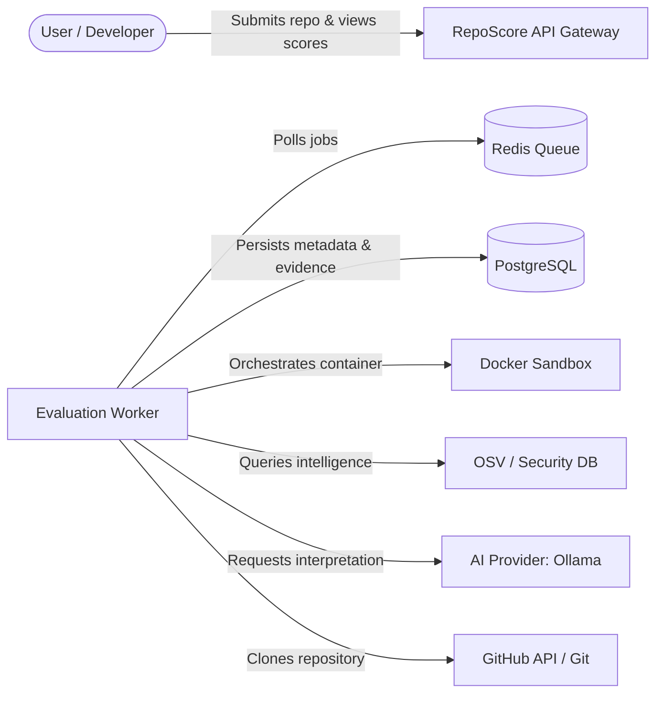

# Master Software Requirements Specification (SRS)

> **Document:** `SRS.md`  
> **System:** RepoScore — Autonomous Repository Intelligence & Software Evaluation Engine  
> **Status:** Active / Requirements Baseline  
> **Authority:** [`docs/architecture/SYSTEM_ARCHITECTURE.md`](file:///c:/Partition/SERIOUS%20PROJECTS/REPO-Score/docs/architecture/SYSTEM_ARCHITECTURE.md), [`AGENTS.md`](file:///c:/Partition/SERIOUS%20PROJECTS/REPO-Score/AGENTS.md)

---

## 1. Introduction

### 1.1 Purpose
This Master Software Requirements Specification (SRS) defines the functional, non-functional, security, operational, and interface requirements for **RepoScore**. It translates the system architecture established in Phase 00 into a comprehensive, testable, and traceable set of engineering specifications.

RepoScore evaluates software repositories on empirical evidence rather than superficial appearance:
> **Core Principle:** Do not merely analyze what the code looks like. Determine what the software actually does.

### 1.2 Product Vision
RepoScore provides automated, reproducible, and objective intelligence regarding the quality, security, reliability, and engineering maturity of software repositories. By combining deep static analysis, dependency vulnerability auditing, isolated runtime execution within quarantined sandboxes, mathematical scoring, and bounded AI interpretation, RepoScore delivers actionable, evidence-backed evaluation scorecards without human bias or manual overhead.

### 1.3 Scope
- **In-Scope (System Boundaries):**
  - Ingestion of public GitHub repositories into immutable snapshot archives.
  - Heuristic and manifest-driven technology detection.
  - Multi-engine static analysis and dependency vulnerability auditing.
  - Isolated containerized building, startup probing, and runtime telemetry collection.
  - Canonical evidence generation, validation, and immutable persistence.
  - 100% deterministic, mathematical scoring across 10 engineering dimensions.
  - Local-first AI-assisted interpretation, explanation synthesis, and synthetic test generation.
  - RESTful HTTP API and Server-Sent Events (SSE) progress streaming.
  - Next.js administrative and diagnostic web dashboard.
- **Out-of-Scope:**
  - Direct execution of untrusted code on the host operating system.
  - Modifying or writing back commits to upstream third-party repositories.
  - Mandatory paid third-party cloud services or proprietary AI APIs.
  - Multi-tenant enterprise billing, payment gateways, and SAML/SSO workflows in initial release.

---

## 2. Definitions and Acronyms

| Term | Definition |
|---|---|
| **ADR** | Architecture Decision Record. Formal record of architectural decisions. |
| **API** | Application Programming Interface (HTTP/REST). |
| **AST** | Abstract Syntax Tree. Generated by parsers like Tree-sitter for syntactic analysis. |
| **cgroups v2** | Linux Control Groups v2. Kernel mechanism used to enforce CPU, RAM, and I/O quotas. |
| **CVE** | Common Vulnerabilities and Exposures. Standardized identifier for known security flaws. |
| **Evidence** | An atomic, verifiable, normalized datum observed during static analysis, runtime execution, or vulnerability scanning. |
| **Host** | The trusted physical or virtual machine running the RepoScore orchestrator, API, and worker processes. |
| **Immutable Snapshot** | An exact, tamper-proof directory archive of a repository frozen at a specific Git commit SHA. |
| **Ollama** | Self-hosted, local open-source LLM inference runtime. |
| **OSV** | Open Source Vulnerabilities database and schema. |
| **P0 / P1 / P2 / P3** | Priority ratings: P0 (Essential MVP/Security), P1 (MVP Quality), P2 (Post-MVP), P3 (Future). |
| **RFC 7807** | Problem Details for HTTP APIs specification for structured error payloads. |
| **Sandbox** | An unprivileged, network-restricted, capability-stripped container executing untrusted repository code. |
| **Score Dimension** | One of 10 discrete engineering categories (e.g., Security, Correctness) scored from 0 to 100. |
| **SSE** | Server-Sent Events. Unidirectional HTTP streaming protocol for real-time progress updates. |
| **UID 10001** | The unprivileged, non-root user account enforced inside all sandbox execution environments. |

---

## 3. System Actors & Stakeholders



### 3.1 User
A human software engineer, technical lead, or automated CI system that submits a repository for evaluation and consumes the resulting scorecard, evidence, and recommendations.

### 3.2 Evaluation Worker
A trusted background daemon running on the host that claims queued evaluations, coordinates repository cloning, dispatches static analyzers, controls sandbox lifecycles, collects telemetry, executes scoring algorithms, and interfaces with the AI provider.

### 3.3 Sandbox
An isolated, hostile-code-quarantined Docker container governed by cgroups v2 resource ceilings, stripped of all Linux capabilities (`--cap-drop=ALL`), running as non-root UID 10001, executing repository build scripts and test suites.

### 3.4 AI Provider
An auxiliary reasoning service (defaulting to local Ollama) invoked strictly for structured interpretation, failure explanation, and scenario generation. The AI provider is strictly prohibited from generating authoritative scores or fabricating evidence.

### 3.5 GitHub
The external source code management service providing Git repository trees, commit metadata, and release tags over HTTPS.

### 3.6 Security Intelligence Sources
Open-source and local security databases (e.g., OSV.dev, Trivy DB) queried offline or via bounded lookups to map package dependencies to known CVEs and advisories.

---

## 4. System Constraints

### 4.1 Architectural Constraints
1. **Modular Monolith:** Single unified backend application layout with strict domain boundary separation and Python `typing.Protocol` interfaces (ADR-001).
2. **Asynchronous Hand-off:** API endpoints accept submissions asynchronously, returning HTTP 202 Accepted and delegating work to Redis-backed worker queues (ADR-007).
3. **Relational Persistence:** PostgreSQL 16+ is the single source of truth for relational state, relational integrity, and JSONB payloads (ADR-006).

### 4.2 Security Constraints
1. **Zero Host Execution:** Untrusted repository code, build scripts, package managers, and binaries MUST NEVER execute directly on the host OS.
2. **Hardened Container Perimeter:** Sandboxes must drop all Linux capabilities, run as non-root, use read-only root filesystems, and restrict network egress (ADR-002).
3. **No Docker Socket Mounting:** The host Docker socket (`/var/run/docker.sock`) MUST NEVER be mounted inside untrusted sandbox containers.
4. **Secret Redaction:** Logs, database fields, and API payloads must redact environment credentials, tokens, and private keys.

### 4.3 Operational Constraints
1. **Free-First Ecosystem:** All core dependencies must be open-source and capable of running self-hosted without paid external cloud subscriptions (ADR-005, ADR-006).
2. **Deterministic Reproducibility:** Calculations must be identical across repeated runs on the same evidence set (ADR-004).

---

## 5. Primary User Journeys

### 5.1 Journey 1: Repository Submission & Enqueueing
1. User provides a GitHub URL (e.g., `https://github.com/fastapi/fastapi`) via web UI or `POST /repositories`.
2. RepoScore validates URL syntax, checks repository accessibility, and records the `Repository` entity.
3. User triggers an evaluation via `POST /evaluations`.
4. System creates an `Evaluation` in `QUEUED` state and pushes a job payload to the Redis queue.
5. User receives `202 Accepted` with a correlation ID and status tracking URL.

### 5.2 Journey 2: Real-time Evaluation Progress Monitoring
1. User connects to `GET /evaluations/{id}/events` via Server-Sent Events (SSE) or polls `GET /evaluations/{id}/status`.
2. Worker claims job, transitioning through lifecycle states:
   `QUEUED` → `INGESTING` → `ANALYZING` → `BUILDING` → `STARTING` → `TESTING` → `OBSERVING` → `SCORING` → `AI_INTERPRETATION` → `COMPLETED`.
3. Client receives granular progress updates, active step indicators, and intermediate warnings in real time.

### 5.3 Journey 3: Scorecard & Evidence Exploration
1. Evaluation completes; user navigates to the evaluation report dashboard.
2. User reviews the overall composite score (0–100), letter grade (A+ through F), and individual radar chart of 10 dimensions.
3. User inspects itemized scoring deductions, drilling down into linked normalized evidence items (file, line number, tool, severity).
4. User reads the AI-generated executive summary, architectural assessment, and prioritized remediation recommendations.

### 5.4 Journey 4: Handling Build/Runtime Failures (Partial Evaluation)
1. Repository contains broken dependencies or fails during compile/startup.
2. The sandbox captures stderr, compiler error messages, and process exit code as negative evidence.
3. System transitions state to `BUILD_FAILED` or `STARTUP_FAILED`, and immediately routes to `SCORING` instead of aborting.
4. Scoring engine assesses appropriate penalties for Correctness and Reliability while crediting static analysis and security dimensions.
5. Evaluation finalizes in `PARTIALLY_COMPLETED`, delivering full diagnostic evidence and AI root-cause analysis to the user.

---

## 6. Master Requirements Index

The requirements are partitioned into specialized documents. Below is the master structural index:

| Requirement Group | Document Reference | ID Prefix | Total Req Count | Primary Architectural Owner |
|---|---|---|---|---|
| **Functional Requirements** | [`FUNCTIONAL_REQUIREMENTS.md`](file:///c:/Partition/SERIOUS%20PROJECTS/REPO-Score/docs/requirements/FUNCTIONAL_REQUIREMENTS.md) | `FR-xxx` | 40 | Repository Manager, Orchestrator, Evidence Engine |
| **Non-Functional Requirements** | [`NON_FUNCTIONAL_REQUIREMENTS.md`](file:///c:/Partition/SERIOUS%20PROJECTS/REPO-Score/docs/requirements/NON_FUNCTIONAL_REQUIREMENTS.md) | `NFR-xxx` | 32 | Platform Architecture, Infrastructure, Telemetry |
| **Security Requirements** | [`SECURITY_REQUIREMENTS.md`](file:///c:/Partition/SERIOUS%20PROJECTS/REPO-Score/docs/requirements/SECURITY_REQUIREMENTS.md) | `SEC-xxx` | 30 | Sandbox Manager, Security Engine, Ingestion |
| **API Requirements** | [`API_REQUIREMENTS.md`](file:///c:/Partition/SERIOUS%20PROJECTS/REPO-Score/docs/requirements/API_REQUIREMENTS.md) | `API-xxx` | 22 | API Gateway Layer |
| **Evaluation Lifecycle & Runtime** | [`EVALUATION_REQUIREMENTS.md`](file:///c:/Partition/SERIOUS%20PROJECTS/REPO-Score/docs/requirements/EVALUATION_REQUIREMENTS.md) | `EVAL-xxx` | 32 | Evaluation Orchestrator, Runtime Engine |
| **Deterministic Scoring** | [`SCORING_REQUIREMENTS.md`](file:///c:/Partition/SERIOUS%20PROJECTS/REPO-Score/docs/requirements/SCORING_REQUIREMENTS.md) | `SCORE-xxx` | 24 | Scoring Engine |
| **AI Auxiliary Engine** | [`AI_REQUIREMENTS.md`](file:///c:/Partition/SERIOUS%20PROJECTS/REPO-Score/docs/requirements/AI_REQUIREMENTS.md) | `AI-xxx` | 20 | AI Provider Adapter |
| **MVP Scope** | [`MVP_SCOPE.md`](file:///c:/Partition/SERIOUS%20PROJECTS/REPO-Score/docs/requirements/MVP_SCOPE.md) | N/A | Definition | Core Project Delivery |
| **Out-of-Scope Declarations** | [`OUT_OF_SCOPE.md`](file:///c:/Partition/SERIOUS%20PROJECTS/REPO-Score/docs/requirements/OUT_OF_SCOPE.md) | N/A | Boundaries | Governance |
| **Traceability Matrix** | [`TRACEABILITY_MATRIX.md`](file:///c:/Partition/SERIOUS%20PROJECTS/REPO-Score/docs/requirements/TRACEABILITY_MATRIX.md) | N/A | Matrix | Quality Assurance |

---

## 7. Requirement Priority Distribution

All requirements follow the standard four-tier classification:
- **P0 (Mandatory Core / Security / MVP):** Must be fully satisfied for MVP correctness, safety, and deterministic scoring.
- **P1 (MVP Quality & Completeness):** Important for robust operation, fault tolerance, and comprehensive telemetry in MVP.
- **P2 (Post-MVP Enhancements):** Valuable enhancements scheduled immediately after initial vertical slice validation.
- **P3 (Future Architecture Goals):** Long-term expansion items (e.g., MicroVMs, distributed worker fleets).

---

## 8. Acceptance Criteria Strategy

All P0 requirements and critical lifecycle transitions must include formal acceptance criteria defined using Gherkin syntax (`Given ... When ... Then ...`).

Example Standard Pattern:
```gherkin
Given an untrusted repository contains a malicious setup.py with arbitrary host shell commands
When RepoScore executes the build step of the evaluation
Then the command must execute strictly inside the ephemeral sandbox container
And the host operating system must remain completely untouched
And the worker process must capture any malicious execution attempts as security evidence
```

These criteria serve as direct specifications for automated tests in subsequent phases:
- Unit tests (`tests/unit/`)
- Integration tests (`tests/integration/`)
- Security & adversarial suites (`tests/security/`, `tests/adversarial/`)

---

## 9. Tracking of Unbenchmarked Metrics (No Fake Precision)

In strict accordance with Phase 01 rules, performance thresholds that have not been validated through empirical load testing are explicitly marked:
> `TBD — requires benchmarking` or `TBD — requires security validation`

These items are indexed in Section 10 below and will be resolved through formal benchmark reports in Phase 16 (Observability & Hardening).

### 9.1 Open Questions & TBD Index
1. **Ingestion Max Repository Size:** Initial default 250MB uncompressed; final threshold `TBD — requires benchmarking` based on worker disk I/O performance.
2. **Concurrent Sandbox Density:** Target 4 containers per 8-core/16GB worker; maximum saturation limit `TBD — requires benchmarking`.
3. **Egress Proxy Latency Overhead:** Package caching proxy overhead target < 15%; `TBD — requires benchmarking`.
4. **Local LLM Token Generation Rate:** Ollama 8B inference latency target < 20s per summary; `TBD — requires benchmarking` across supported CPU/GPU hardware profiles.
