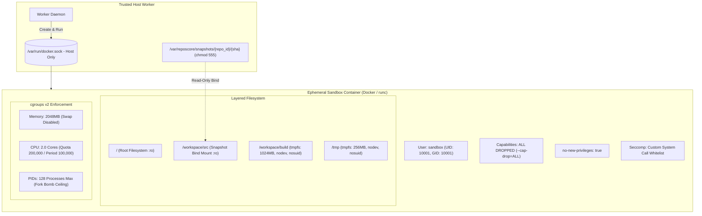
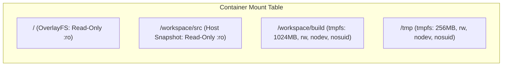
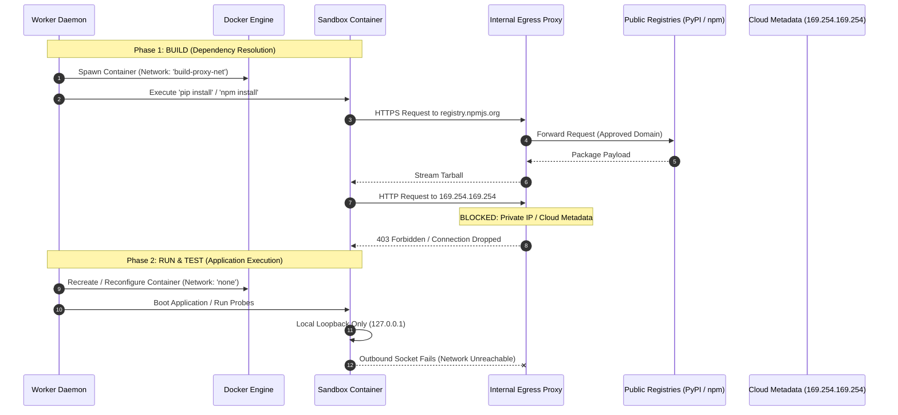

# Sandbox Security & Confinement Specification

> **Document:** `SANDBOX_SECURITY_SPEC.md`  
> **System:** RepoScore — Autonomous Repository Intelligence & Software Evaluation Engine  
> **Status:** Active / Security Baseline  
> **Phase:** Phase 02 — Threat Model and Sandbox Security Specification  
> **Authority:** `phases/02_SECURITY.md`, `phases/00_ARCHITECTURE.md`, `AGENTS.md`

---

## 1. Sandbox Purpose & Architecture

The **Sandbox Subsystem** is the execution perimeter responsible for quarantining untrusted code during evaluation builds, dependency resolution, application startup, and synthetic probing.

All untrusted processes execute strictly within ephemeral, non-root, capability-stripped Docker containers managed by the host worker via the Docker Engine API.



---

## 2. Kernel Isolation & User Hardening

### 2.1 Non-Root User Identity
Containers MUST NOT run as root under any circumstance:
- **User Name:** `sandbox`
- **UID:** `10001`
- **GID:** `10001`
- **Home Directory:** `/home/sandbox` (read-only)
- **Login Shell:** `/bin/sh` or `/bin/bash`
- **Sudo / Su:** Completely absent or permissions stripped (`chmod 000 /usr/bin/sudo`)
- **Docker CLI Flag:** `--user 10001:10001`

### 2.2 Complete Linux Capability Stripping
All 38 standard Linux kernel capabilities are stripped at container initialization:
- **Docker CLI Flag:** `--cap-drop=ALL`
- **Dropped Capabilities Include:**
  - `CAP_CHOWN`: Prevents changing file ownership
  - `CAP_DAC_OVERRIDE`: Prevents bypassing file read/write permission checks
  - `CAP_FOWNER`: Prevents overriding file ownership checks
  - `CAP_NET_RAW`: Prevents crafting raw sockets, packet sniffing, and spoofing
  - `CAP_NET_BIND_SERVICE`: Prevents binding to privileged ports (< 1024)
  - `CAP_SYS_ADMIN`: Prevents mount, namespace manipulation, and hardware access
  - `CAP_SYS_PTRACE`: Prevents process tracing and memory injection
  - `CAP_SYS_RAWIO`: Prevents raw hardware I/O access
  - `CAP_SYS_MODULE`: Prevents loading Linux kernel modules
  - `CAP_SYS_CHROOT`: Prevents altering root directory namespace
  - `CAP_SETUID` / `CAP_SETGID`: Prevents user/group identity escalation

### 2.3 Privilege Escalation Prohibition (`no-new-privileges`)
To neutralize setuid binaries, suid scripts, or capability expansion during process execution:
- **Docker CLI Flag:** `--security-opt=no-new-privileges:true`
- **Kernel Enforcement:** Sets `PR_SET_NO_NEW_PRIVS` via `prctl(2)` on process birth. Processes cannot acquire new privileges through `execve()`, even if encountering a setuid binary.

---

## 3. Seccomp Syscall Filtering Profile

RepoScore enforces a strict custom Seccomp (Secure Computing Mode) profile:
- **Default Action:** `SCMP_ACT_ERRNO` (returns `EPERM` for any unlisted syscall).
- **Architecture Whitelist:** `SCMP_ARCH_X86_64`, `SCMP_ARCH_AARCH64`.

### 3.1 Explicitly Blacklisted / Denied Syscalls
The following dangerous syscalls are explicitly intercepted and denied with `EPERM`:
| Syscall | Threat Category | Rationale |
|---|---|---|
| `ptrace` | Memory Injection | Denies attaching to or inspecting other container/host processes |
| `sys_chroot` | Jailbreak | Denies creating nested chroot environments |
| `mount` / `umount2` | Filesystem Manipulation | Denies modifying filesystem mounts |
| `bpf` | Kernel Execution | Denies loading eBPF programs into host kernel space |
| `keyctl` | Secret Extraction | Denies accessing Linux kernel keyring |
| `kexec_load` | Kernel Hijack | Denies loading alternative kernels |
| `reboot` | DoS | Denies triggering container shutdown syscalls |
| `perf_event_open`| Side-Channel Leakage | Denies hardware performance counter inspection |
| `userfaultfd` | Exploit Primitive | Denies user-space page fault manipulation (common in kernel exploits) |
| `clone3` | Namespace Escalation | Restricts process cloning flags that attempt new user namespaces |

### 3.2 Whitelisted Syscalls for Application Runtimes
Only standard operational syscalls required for Python, Node.js, and POSIX runtimes are permitted:
- **Process & Lifecycle:** `execve`, `exit`, `exit_group`, `fork`, `vfork`, `clone`, `wait4`, `getpid`, `getppid`, `getuid`, `getgid`, `set_tid_address`, `arch_prctl`, `prctl` (read-only flags).
- **Filesystem I/O:** `read`, `write`, `open`, `openat`, `close`, `stat`, `fstat`, `lstat`, `newfstatat`, `lseek`, `access`, `faccessat`, `getcwd`, `mkdir`, `mkdirat`, `unlink`, `unlinkat`, `readlink`, `readlinkat`, `fcntl`, `ioctl` (safe TTY ioctls only), `dup`, `dup2`, `pipe`, `pipe2`, `select`, `pselect6`, `poll`, `epoll_create1`, `epoll_ctl`, `epoll_wait`.
- **Memory Management:** `brk`, `mmap`, `munmap`, `mprotect`, `madvise`.
- **Time & Signals:** `clock_gettime`, `gettimeofday`, `nanosleep`, `rt_sigaction`, `rt_sigprocmask`, `rt_sigreturn`, `sigaltstack`, `alarm`.
- **Networking (Build Phase Only):** `socket`, `connect`, `sendto`, `recvfrom`, `sendmsg`, `recvmsg`, `getsockopt`, `setsockopt`, `getpeername`, `getsockname`.

---

## 4. Filesystem Isolation & Mount Architecture

The filesystem perimeter employs a strictly layered read-only architecture:



### 4.1 Read-Only Root Filesystem
- **Configuration:** `--read-only`
- The base container image filesystem (`/bin`, `/usr`, `/lib`, `/etc`) is strictly read-only. Any attempt to modify system binaries, install rootkits, or alter `/etc/passwd` fails immediately with `EROFS (Read-only file system)`.

### 4.2 Read-Only Snapshot Bind Mount
- **Host Source:** `/var/reposcore/snapshots/{repo_id}/{commit_sha}`
- **Container Target:** `/workspace/src`
- **Mount Mode:** `:ro` (Read-Only Bind Mount)
- **File Permissions:** Host filesystem files are marked `chmod -R 555`. Repository source code cannot be mutated or tampered with during evaluation.

### 4.3 Ephemeral Memory-Backed Scratchpads (TMPFS)
Writable directories exist exclusively in memory (`tmpfs`), bounded in size, and stripped of device and suid permissions:
1. **Build Workspace:**
   - `--tmpfs /workspace/build:rw,noexec,nosuid,nodev,size=1024m`
   - *Note:* If the build step requires compiling native binary extensions (e.g. C/C++ via wheels), `noexec` is lifted solely for `/workspace/build` during the build step, while keeping `nosuid,nodev` strictly enforced.
2. **Temporary Directory:**
   - `--tmpfs /tmp:rw,nosuid,nodev,size=256m`

---

## 5. Resource Denial-of-Service Defense (cgroups v2)

Every container instance is placed into an isolated cgroups v2 slice with hard-enforced resource ceilings:

### 5.1 Memory Quotas
- **Hard Memory Limit:** `2048MB` (`--memory=2048m`)
- **Swap Limit:** `2048MB` (`--memory-swap=2048m`, setting swap equal to memory completely disables disk swapping).
- **Kernel OOM Behavior:** `--oom-kill-disable=false`. If runaway memory allocation exceeds 2GB, the Linux kernel Out-Of-Memory killer terminates the offending process with `SIGKILL` (exit code `137`).
- **Telemetry Capture:** Worker logs exit code 137 as an explicit evidence item: `RUNTIME_OOM_KILLED`.

### 5.2 CPU Quotas
- **CPU Limit:** `2.0 cores` (`--cpus=2.0`)
- **cgroups v2 Enforcement:**
  - `cpu.max = 200000 100000` (Allows max 200,000 microseconds of CPU time per 100,000 microsecond period).
  - `cpu.weight = 100` (Equal CPU fairness relative to host processes).
- Multi-threaded busy loops are throttled cleanly at the 2.0 core ceiling without starving worker host threads.

### 5.3 Process Ceiling (Fork Bomb Defense)
- **Process Limit:** `128 processes` (`--pids-limit=128`)
- Any bash or Python fork bomb attempting to exhaust kernel thread tables hits `EAGAIN` at 128 PIDs. The container process tree cannot expand further, preserving host system stability.

### 5.4 Output Buffer Truncation (Anti-Log Flooding)
- Container `stdout` and `stderr` streams are captured via an in-memory streaming pipe.
- **Maximum Buffer Size:** `10MB` per step.
- If output exceeds 10MB, the stream reader terminates further writes, logs `[TRUNCATED: Maximum step output buffer exceeded]`, and silently discards excess bytes.

---

## 6. Phased Network Isolation Policy

RepoScore enforces a strict two-phase network isolation model:



### 6.1 Phase 1: Build Phase (Restricted Egress Proxy)
During dependency installation, containers are attached to a dedicated Docker bridge network (`reposcore-build-net`) whose default gateway routes through an internal forward proxy (e.g., Envoy or Squid):
- **Egress Whitelist (Strict Domain Matching):**
  - Python: `pypi.org`, `files.pythonhosted.org`
  - Node.js: `registry.npmjs.org`
- **Explicit Deny Rules:**
  - Cloud Metadata Services: `169.254.169.254` (Dropped)
  - RFC 1918 Private IPv4: `10.0.0.0/8`, `172.16.0.0/12`, `192.168.0.0/16` (Dropped)
  - Host Localhost: `127.0.0.1`, `host.docker.internal` (Dropped)
  - Docker Socket: `/var/run/docker.sock` (Unreachable)
  - Non-HTTP(S) Protocols: SSH, FTP, SMTP, raw TCP/UDP sockets (Dropped)

### 6.2 Phase 2: Runtime & Test Phase (Absolute Network Severance)
During application startup, synthetic HTTP probing, and test execution:
- **Docker CLI Flag:** `--network none`
- Only the container loopback interface (`lo` / `127.0.0.1`) is created.
- Any attempt to open an external socket returns `ENETUNREACH (Network is unreachable)`.
- Synthetic probes connect to the application via an internal ephemeral Unix domain socket or a tightly scoped inter-container bridge configured without external routing.

---

## 7. Secret & Environment Variable Isolation

### 7.1 Environment Variable Whitelisting
Host worker environment variables contain sensitive credentials: `DATABASE_URL`, `REDIS_PASSWORD`, `GITHUB_TOKEN`, and `ENCRYPTION_KEY`.
- Containers MUST NOT inherit host environment variables.
- Injected environment variables are strictly restricted to:
  ```json
  {
    "PATH": "/usr/local/bin:/usr/bin:/bin",
    "LANG": "C.UTF-8",
    "LC_ALL": "C.UTF-8",
    "HOME": "/home/sandbox",
    "USER": "sandbox",
    "PYTHONPATH": "/workspace/src:/workspace/build",
    "NODE_PATH": "/workspace/build/node_modules"
  }
  ```

### 7.2 Automated Output Redaction
All console logs, stdout/stderr streams, and error messages captured from sandbox execution pass through an automated regular expression redaction filter before database persistence:
- GitHub Personal Access Tokens: `ghp_[a-zA-Z0-9]{36}` $\to$ `[REDACTED_GH_TOKEN]`
- AWS Access Keys: `AKIA[0-9A-Z]{16}` $\to$ `[REDACTED_AWS_KEY]`
- Private Key Headers: `-----BEGIN .* PRIVATE KEY-----` $\to$ `[REDACTED_PRIVATE_KEY]`
- Database URLs: `postgres://.*:.*@` $\to$ `postgres://[REDACTED]@`

---

## 8. Ephemeral Lifecycle & Teardown Invariants

1. **Deterministic Naming & Tagging:**
   - Every sandbox container is assigned a unique name: `reposcore-sandbox-{evaluation_id}-{step_name}`.
   - Every container is tagged with Docker labels:
     `reposcore.evaluation_id = "{uuid}"`
     `reposcore.created_at = "{iso8601}"`
2. **Graceful vs Forced Teardown Protocol:**
   - When a step finishes or times out, the worker dispatches `SIGTERM` to the container process.
   - If processes do not exit within 5 seconds, the worker issues `SIGKILL` via Docker API (`docker kill`).
   - The worker immediately calls `docker rm -f -v {container_id}` to purge the container and ephemeral volumes.
3. **Host Orphan Container Sweeper:**
   - A supervisor daemon executes on every worker host every 60 seconds.
   - Any container with label `reposcore.evaluation_id` whose creation timestamp exceeds the global timeout plus grace period ($600\text{s} + 60\text{s} = 660\text{s}$) is forcefully killed and removed.
